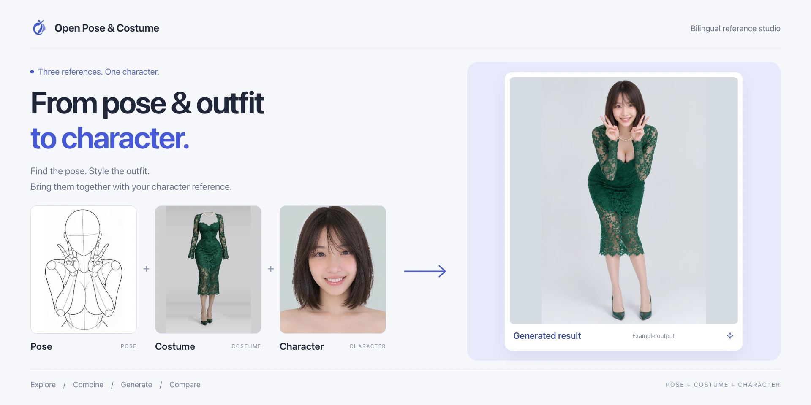
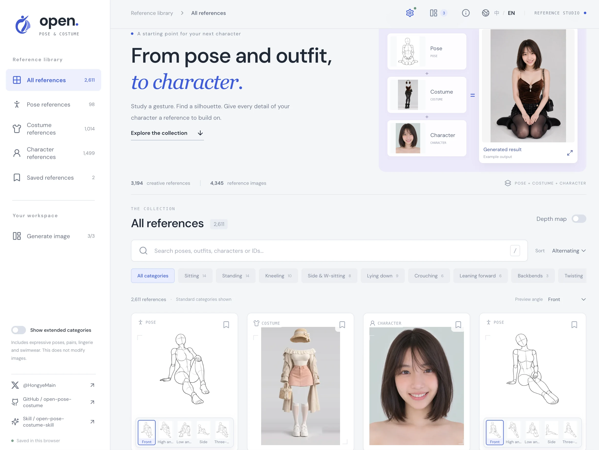
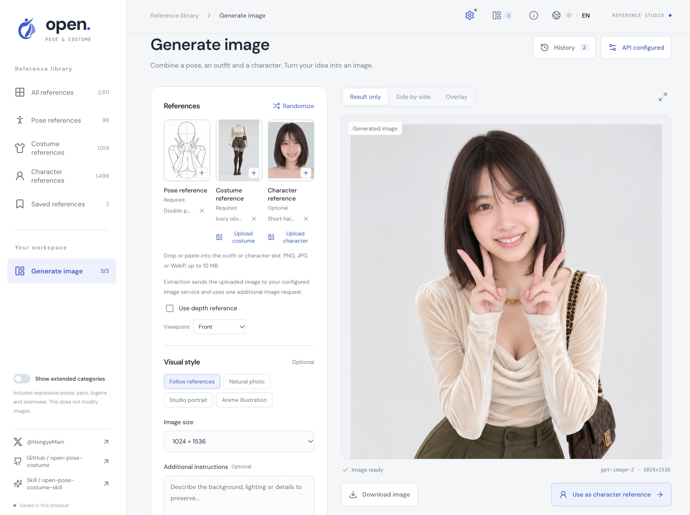
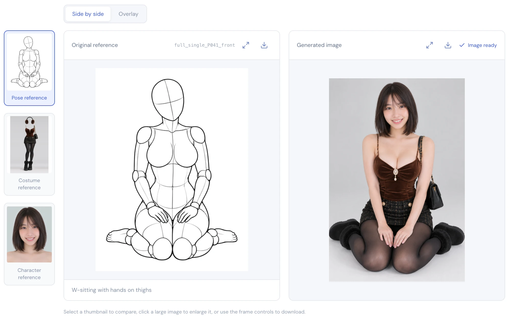
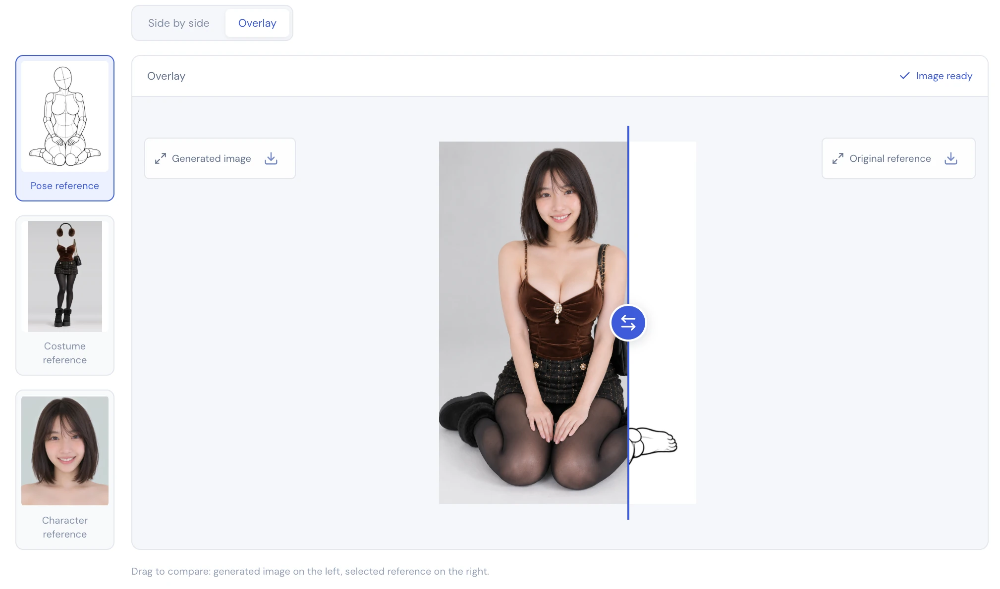

<div align="center">


# Open Pose & Costume

### From pose and outfit to character

A bilingual reference studio for character design, drawing practice and AI creation.<br />
Find inspiration, combine references and generate characters in one place.

**[Try the studio ↗](https://hongye007.github.io/open-pose-costume/)** &nbsp; · &nbsp; [Character generation skill](https://github.com/hongye007/open-pose-costume-skill) &nbsp; · &nbsp; [Free trial guide](https://my.feishu.cn/wiki/DuwOwjo0oiUrMAkVY8McigKcnsh)

[中文](README.md) / **English** &nbsp; · &nbsp; [Author on X · @HongyeMain](https://x.com/HongyeMain)

</div>



<table align="center">
  <thead>
    <tr>
      <th align="center">Pose references</th>
      <th align="center">Outfits</th>
      <th align="center">Character references</th>
      <th align="center">Reference images</th>
    </tr>
  </thead>
  <tbody>
    <tr>
      <td align="center"><strong>288</strong> groups · <strong>1,439</strong> views</td>
      <td align="center"><strong>1,407</strong></td>
      <td align="center"><strong>1,499</strong></td>
      <td align="center"><strong>4,345</strong></td>
    </tr>
  </tbody>
</table>

<div align="center">
<sub>Includes extended categories · Updated October 30, 2026 (Asia/Shanghai)</sub>
</div>

<p align="center">
<a href="#browse-and-save">Browse &amp; save</a> ·
<a href="#pose-outfit-and-character-generate-an-image">Generate</a> ·
<a href="#companion-skill">Companion skill</a> ·
<a href="#run-locally">Run locally</a> ·
<a href="#license-and-credits">License</a>
</p>

---

## Browse and save

- **Three libraries, one search**: browse poses, outfits and characters. Search by Chinese or English name, keyword or ID, then narrow results with categories, sorting and character hair-length filters.
- **Angles and depth maps**: switch pose viewpoints or preview depth maps. Lists use thumbnails; open details to enlarge and download originals. Extended categories can be enabled separately.
- **Favorites and sharing**: save references and return to “Saved references” to continue pairing or download them. Share links preserve language, filters and reference selections.
- **Continuous browsing**: responsive layout, lazy-loaded images and automatic loading as you scroll. Press `/` to search, `←` / `→` to navigate in the detail view, and `Esc` to close it.



The character library includes **893 face and 606 styling references**, with hair-length filters. Only hair length has complete source classifications; some style descriptions mention hair color, but dedicated eye-color, hair-color and skin-tone labels are unavailable.

## Pose, outfit and character. Generate an image.

Open “Generate image” from the sidebar. Choose references and settings on the left, then view the result on the right. **A pose and an outfit are required; a character reference is optional.** The pose guides the action, the outfit guides clothing, and the character reference helps preserve identity and appearance. Choose library references or click “Randomize” for inspiration.



### From references to an image

1. **Configure the service**: click “Configure image service” or the settings icon in the upper-right corner, then enter the service URL, API key and model. Generation is disabled until the API is configured.
2. **Choose references**: select a pose and an outfit, then optionally choose a library character or upload your own. Upload, drop or paste PNG, JPG or WebP images up to 10 MB each.
3. **Extract your own outfit**: “Upload costume” opens a dialog. Choose an outfit photo on the left, click “Extract outfit” in the middle, inspect the result on the right, then “Confirm and use.” Extraction makes one additional image request. You can retry failures; the previous reference stays until you confirm.
4. **Adjust and generate**: select a viewpoint, optionally enable depth guidance, and set the visual style, image size and additional instructions. Advanced settings let you edit the full prompt. Click “Generate image”; you can keep browsing while it runs and retry failed requests manually.
5. **Review and keep creating**: switch between “Result only,” “Side by side” and “Overlay,” enlarge or download the result, or select “Use as character reference.” The “History” drawer keeps the latest 20 successful results, with controls to restore references, delete records and download a ZIP of the pose, outfit and optional character references used for that result.

| Setting          | Default or requirement                                                                       |
| ---------------- | -------------------------------------------------------------------------------------------- |
| Service URL      | `https://atomflow.vip`, editable                                                             |
| Model            | `gpt-image-2`, editable                                                                      |
| Endpoint         | `POST /v1/images/edits`, OpenAI-compatible multipart format                                  |
| Reference images | Two originals (pose and costume), or three with an optional character, uploaded as `image[]` |
| Browser access   | Service must allow CORS; use HTTPS or a local HTTP address                                   |

<details>
<summary>How are API keys, images and history stored?</summary>

Settings stay in your browser. The API key is stored only for the current session by default; enabling “Remember key” stores it locally. You can clear it in settings. During generation, the browser sends references and the description directly to your configured service, which may charge for usage. Keys are excluded from share links and the repository.

Library selections are saved as reference IDs in this browser. Lists use thumbnails; details and generation use originals. For uploaded outfits, the original photo is sent to your configured service when you click “Extract outfit.” The confirmed extraction becomes the outfit reference for subsequent generation.

History is stored in this browser using IndexedDB, including generated images, prompts, settings and reference information. Uploaded reference files are also saved with successful results. Uploads without a successful result stay only in page memory. Delete individual records or clear history in the drawer. Images and keys are excluded from share links and the repository; history does not contain API keys.

</details>

### Side by side

View the selected reference beside the generated result to compare the pose and outfit.



### Overlay

Drag the divider within a single frame, with the generated image on the left and the selected reference on the right. Arrow keys and Home / End are supported. If subject sizes or positions differ, select “Align images” to zoom and drag each image before comparing. Alignment affects the preview only, leaving originals and downloads unchanged.



These are example outputs. Results depend on the model, description and service configuration.

## Companion skill

[open-pose-costume-skill](https://github.com/hongye007/open-pose-costume-skill) combines pose, costume and character references into one character image through natural-language requests in Codex. Browse and select references on this website, then use the skill to generate a character. See the skill repository's bilingual README for installation, examples and image service configuration.

## Run locally

Requires **Node.js 22.12+**.

```sh
npm ci
npm run dev
```

Open <http://127.0.0.1:5199>. Strict port checking is enabled, so startup exits if the port is occupied. Check availability before starting, or choose another free port:

```sh
npm run dev -- --port 5200
```

Check with `lsof -nP -iTCP:5200 -sTCP:LISTEN` on macOS/Linux, or `Get-NetTCPConnection -LocalPort 5200` in Windows PowerShell.

## Build and deploy

The site is deployed on [GitHub Pages](https://hongye007.github.io/open-pose-costume/). Pushes to `main` automatically run tests, build with `/open-pose-costume/` as the base path, and deploy through GitHub Actions. Failed tests or builds prevent deployment. Other branches and pull requests only run checks.

CI uses sparse checkout to skip downloading and checking out the `pose/` and `costume/` image archives while retaining files needed for tests and builds.

Built with **React 19 · TypeScript · Vite · Lucide**. The reference library is a static website; image generation requires your own service configuration.

```sh
npm run build
```

Deploy `dist/` to a static host. For Cloudflare Pages, use `npm run build` as the build command and `dist` as the output directory. `public/_headers` supplies cache and security headers on Cloudflare Pages; GitHub Pages does not read this file.

Choose a free port for local preview as well:

```sh
npm run preview -- --port 5200
```

## Data and maintenance

The website loads images directly from the source sites, so availability depends on those sites. Local image archives do not change the URLs used by the website.

Character metadata comes from [AI Portrait Gallery](https://ai-portrait-gallery.pages.dev/). Portrait thumbnails and originals are not downloaded or archived in this repository and are excluded from `images:download`.

| Command                   | Purpose                                                                           |
| ------------------------- | --------------------------------------------------------------------------------- |
| `npm run sync`            | Sync upstream metadata without executing upstream page code or downloading images |
| `npm run data:build`      | Rebuild the website index from local snapshots                                    |
| `npm test`                | Run tests                                                                         |
| `npm run build`           | Type-check and build the website                                                  |
| `npm run images:download` | Optional: archive covers and originals from all categories locally                |

Metadata snapshots live in `data/source/`, the website index in `public/data/catalog.json`, and sync records in `data/sync-manifest.json`. Sync checks categories, angles and translation coverage. If translations are missing, update the dictionaries indicated by the error.

<details>
<summary>Image archives and brand assets</summary>

The archive retains every available pose angle. The current dataset produces 5,692 files:

```text
pose/
  covers/       # 1,439 JPG thumbnails
  originals/    # 1,439 PNG originals
costume/
  covers/       # 1,407 WebP thumbnails
  originals/    # 1,407 PNG originals
```

Covers and originals are tracked in Git, totaling approximately 1.95 GiB. The archives are excluded from site builds; the website continues to use upstream image URLs. The maintainer confirms additional permission from the original creator for public redistribution in this repository. Images are not covered by the code's MIT license; see [SOURCES.md](SOURCES.md).

Downloads support SHA-256 verification, retries and reuse of existing files. Default concurrency is 8; adjust it with `npm run images:download -- --concurrency 4`. The manifest and summary are written to `data/image-download-manifest.json` and `data/image-download-summary.json`. Download records remain ignored by Git.

See the [original logo](output/imagegen/open-pose-costume-logo-original.png) and [generation prompt](assets/brand/logo-prompt.txt). With Python Pillow and NumPy installed, run `python3 scripts/build-brand-assets.py` to generate the transparent mark, favicon and Apple touch icon.

</details>

## License and credits

The portrait source states [CC0 1.0](https://creativecommons.org/publicdomain/zero/1.0/) while requesting no republication or redistribution of image data. Portraits depict fictional AI-generated people. Both statements are recorded in [SOURCES.md](SOURCES.md).

Project code uses the [MIT license](LICENSE). Images, upstream data and third-party translations retain their respective rights and are not covered by the code license. The pose and costume source terms allow reference, editing and commercial work production, but prohibit redistribution, republication or resale of the image data itself, including edited copies. See [SOURCES.md](SOURCES.md) and [THIRD_PARTY_NOTICES.md](THIRD_PARTY_NOTICES.md) for attribution and full usage restrictions.

Thanks to the original pose and costume creator and the Chinese translation contributors.
