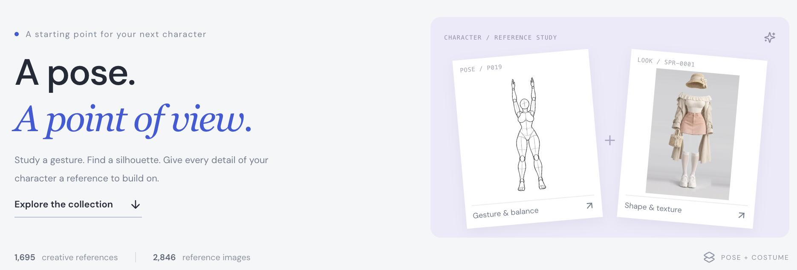
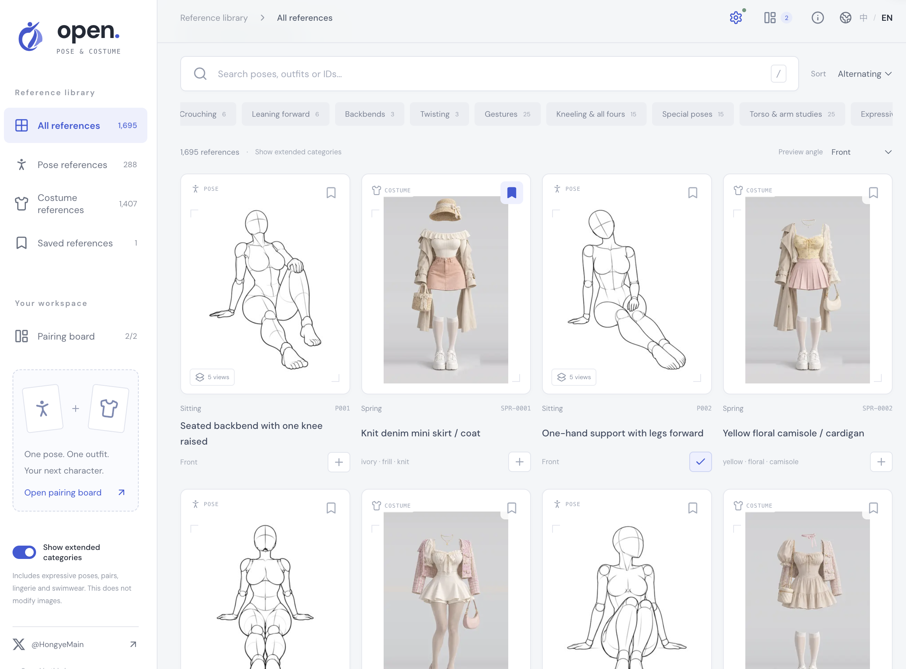
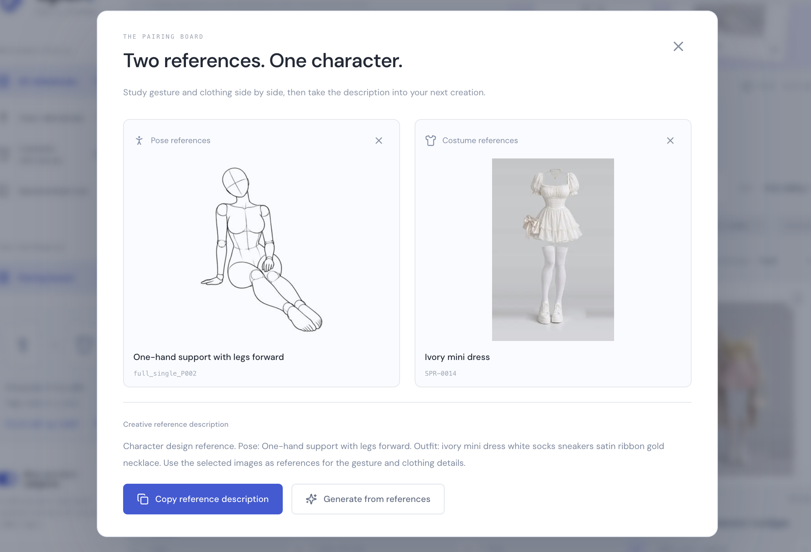
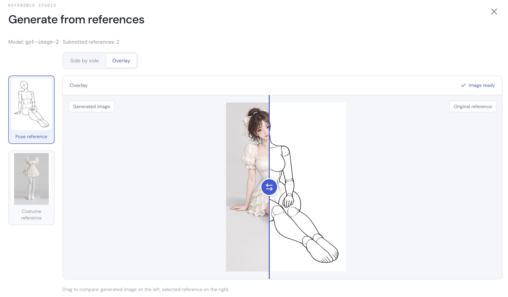

# Open Pose & Costume

[中文](README.md) · **English**

[Live demo](https://hongye007.github.io/open-pose-costume/)

A pose. A point of view. A bilingual reference studio for character design, drawing practice and AI creation: find references, pair a pose with an outfit, generate a character and compare the result.



**288 pose groups · 1,439 pose views · 1,407 outfits · 2,846 reference images**

Counts include extended categories. Data updated on October 30, 2026 (Asia/Shanghai).

## Browse and save

- **Bilingual search**: find references by name, keyword, ID or multiple terms, across Chinese and English.
- **Categories and angles**: filter and sort poses or costumes, switch pose angles, and view thumbnails or originals. Enable extended categories when needed.
- **Favorites and sharing**: favorites and pairings stay in your browser. Share links preserve language, filters and reference selections.
- **Easy browsing**: responsive layout, lazy-loaded images and incremental loading. Press `/` to search, `←` / `→` to navigate in the detail view, and `Esc` to close it.



## Two references. One character.

Choose a pose and an outfit, then add them to the pairing board. The description updates with your selections and can be copied for your creative workflow or another image tool.



### Generate from references

1. Open settings in the upper-right corner and enter your service URL, API key, model, image size and quality.
2. Select **both a pose and a costume** on the pairing board, optionally upload a **character reference** to preserve identity and visual style, then click “Generate from references.” Missing pose or costume references prompt you to complete the selection.
3. Wait for the result. Edit the description to generate again, or retry manually if a request fails.
4. Use the pose, costume or character thumbnails on the left to select the comparison reference, and switch between “Side by side” and “Overlay.”

| Setting          | Default or requirement                                                                       |
| ---------------- | -------------------------------------------------------------------------------------------- |
| Service URL      | `https://atomflow.vip`, editable                                                             |
| Model            | `gpt-image-2`, editable                                                                      |
| Endpoint         | `POST /v1/images/edits`, OpenAI-compatible multipart format                                  |
| Reference images | Two originals (pose and costume), or three with an optional character, uploaded as `image[]` |
| Browser access   | Service must allow CORS; use HTTPS or a local HTTP address                                   |

Settings stay in your browser. The API key is stored only for the current session by default; enabling “Remember key” stores it locally. You can clear it in settings. During generation, the browser sends references and the description directly to your configured service, which may charge for usage. Keys are excluded from share links and the repository.

Character references support PNG, JPG and WebP up to 10 MB. The image stays in page memory when the board closes, and clears on page reload or close. It is excluded from browser storage, share links and the repository, and sent to your configured service only when you generate.

**Side by side**: view the selected reference beside the generated result.


**Overlay**: drag the divider within a single frame, with the generated image on the left and the selected reference on the right. Arrow keys and Home / End are supported.



These are example outputs. Results depend on the model, description and service configuration.

## Run locally

Requires **Node.js 22.12+**.

```sh
npm ci
npm run dev
```

Open <http://127.0.0.1:5199>. Strict port checking is enabled, so startup exits if the port is occupied. Check availability before starting, or choose another free port:

```sh
npm run dev -- --port 5200
```

Check with `lsof -nP -iTCP:5200 -sTCP:LISTEN` on macOS/Linux, or `Get-NetTCPConnection -LocalPort 5200` in Windows PowerShell.

## Build and deploy

The site is deployed on [GitHub Pages](https://hongye007.github.io/open-pose-costume/). Pushes to `main` automatically run tests, build with `/open-pose-costume/` as the base path, and deploy through GitHub Actions. Failed tests or builds prevent deployment. Other branches and pull requests only run checks.

CI uses sparse checkout to skip downloading and checking out the `pose/` and `costume/` image archives while retaining files needed for tests and builds.

Built with **React 19 · TypeScript · Vite · Lucide**. The reference library is a static website; image generation requires your own service configuration.

```sh
npm run build
```

Deploy `dist/` to a static host. For Cloudflare Pages, use `npm run build` as the build command and `dist` as the output directory. `public/_headers` supplies cache and security headers on Cloudflare Pages; GitHub Pages does not read this file.

Choose a free port for local preview as well:

```sh
npm run preview -- --port 5200
```

## Data and maintenance

The website loads images directly from the source sites, so availability depends on those sites. Local image archives do not change the URLs used by the website.

| Command                   | Purpose                                                                           |
| ------------------------- | --------------------------------------------------------------------------------- |
| `npm run sync`            | Sync upstream metadata without executing upstream page code or downloading images |
| `npm run data:build`      | Rebuild the website index from local snapshots                                    |
| `npm test`                | Run tests                                                                         |
| `npm run build`           | Type-check and build the website                                                  |
| `npm run images:download` | Optional: archive covers and originals from all categories locally                |

Metadata snapshots live in `data/source/`, the website index in `public/data/catalog.json`, and sync records in `data/sync-manifest.json`. Sync checks categories, angles and translation coverage. If translations are missing, update the dictionaries indicated by the error.

<details>
<summary>Image archives and brand assets</summary>

The archive retains every available pose angle. The current dataset produces 5,692 files:

```text
pose/
  covers/       # 1,439 JPG thumbnails
  originals/    # 1,439 PNG originals
costume/
  covers/       # 1,407 WebP thumbnails
  originals/    # 1,407 PNG originals
```

Covers and originals are tracked in Git, totaling approximately 1.95 GiB. The archives are excluded from site builds; the website continues to use upstream image URLs. The maintainer confirms additional permission from the original creator for public redistribution in this repository. Images are not covered by the code's MIT license; see [SOURCES.md](SOURCES.md).

Downloads support SHA-256 verification, retries and reuse of existing files. Default concurrency is 8; adjust it with `npm run images:download -- --concurrency 4`. The manifest and summary are written to `data/image-download-manifest.json` and `data/image-download-summary.json`. Download records remain ignored by Git.

See the [original logo](output/imagegen/open-pose-costume-logo-original.png) and [generation prompt](assets/brand/logo-prompt.txt). With Python Pillow and NumPy installed, run `python3 scripts/build-brand-assets.py` to generate the transparent mark, favicon and Apple touch icon.

</details>

## License and credits

Project code uses the [MIT license](LICENSE). Images, upstream data and third-party translations retain their respective rights and are not covered by the code license. The source terms allow reference, editing and commercial work production, but prohibit redistribution, republication or resale of the image data itself, including edited copies. See [SOURCES.md](SOURCES.md) and [THIRD_PARTY_NOTICES.md](THIRD_PARTY_NOTICES.md) for attribution and full usage restrictions.

Thanks to the original pose and costume creator and the Chinese translation contributors.

Author on X: [HongyeMain](https://x.com/HongyeMain)
