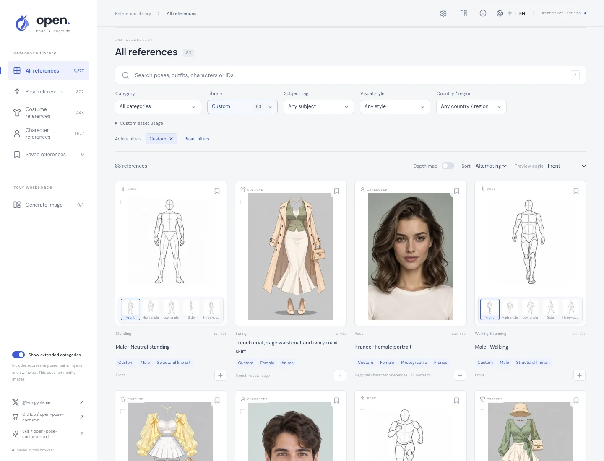

<div align="center">


# Open Pose & Costume

### Find a pose, choose an outfit and character, then generate the complete image

A bilingual reference workspace for character design, drawing practice and AI creation.

**[Try it online](https://omilic.com/)** · [Releases](https://github.com/hongye007/open-pose-costume/releases) · [Character generation Skill](https://github.com/hongye007/open-pose-costume-skill) · [中文](README.md) · [Author on X](https://x.com/HongyeMain)

</div>


<div align="center">

| Poses | Outfits | Characters | Total images |
| :---: | :---: | :---: | :---: |
| **343 groups** · 1,714 views | **2,821 outfits** | **1,538 images** | **6,073 images** |

<sub>Current <code>public/data/catalog.json</code> statistics; preview duplicates are excluded</sub>

</div>

## Highlights

- **Three reference libraries, one workflow**: find poses, outfits and characters, combine them, and generate a finished character image.
- **Fast, structured discovery**: bilingual search, visible codes, categories, sources, gender, visual style, country/region and hair-length filters.
- **Multiple views and depth guidance**: poses can include front, top, low, side and three-quarter views; selected custom poses include AI-inferred relative depth maps.
- **Photographic and anime outfits**: 1,471 photographic and 1,350 anime outfits, filterable by source and style.
- **Two generation options**: free OpenWego generation or high-quality Atomflow generation; customize the OpenAI-compatible URL, key and model.
- **A complete creation loop**: upload characters and outfits, extract clothing, randomize combinations, compare results, download images and restore the latest 20 generations.
- **Local-first data**: favorites, settings and generation history stay in the current browser. Keys are never added to share links or the repository.

## What's New

- Added **free OpenWego generation** with `open-image-v2`: no top-up required, genuinely free and unlimited; an OpenWego API key is required.
- Updated the Atomflow default to `gpt-image-2.6-sunburst`, while keeping editable service URL, API key and model fields for compatible providers.
- Improved the mobile experience with tighter service settings, reference selection and result previews on small screens.
- Added 16 photo-extracted outfits, including two menswear looks, with complete footwear and accessories; the library now contains **343 pose groups, 2,821 outfits and 1,538 character references**.
- HTTP 400 generation errors now include safety-review guidance: change the reference, revise the prompt, or switch to the lower-review OpenWego option.

## How It Works

### 1. Find references

Start with the pose, outfit or character library. Search and filter to narrow the collection. Pose cards can switch views and depth maps independently; favorites stay in this browser.



### 2. Build a combination

Open One-click Generate and choose a **pose + outfit**. A character reference is optional. You can upload or paste PNG, JPG and WebP files up to 10 MB each; uploaded outfit photos can be extracted before generation.

### 3. Choose a service and generate

| Option | Best for | Configuration |
| --- | --- | --- |
| **OpenWego free generation** | Everyday creation with fewer content restrictions | `open-image-v2` by default; API key required; non-flagship model |
| **Custom compatible API** | Your own provider | Edit the URL, key and model under Atomflow; must support `/v1/images/edits` |

Before generation, select a viewpoint, visual style and optional instructions. Size and quality use recommended defaults until expanded. After generation, switch between result-only, side-by-side and overlay views, align images, change the pose, download the result or restore a previous combination.


> Special thanks to [OpenWego](https://openwego.com/) for its free API. OpenWego also offers free reverse prompting, prompt enhancement, style extraction and other tools.

## Generation and Privacy

- OpenWego is called directly from the browser and uses the required API key in the `Authorization` header.
- Default Atomflow requests use Vite locally and can use a restricted Cloudflare Worker in production. Custom compatible endpoints are called directly and must provide correct CORS headers.
- API keys are stored locally in this browser by default. Disable “Remember key” to keep a key only for the current session; settings can be cleared at any time.
- Generation and outfit extraction send the selected references and instructions to the configured provider. Provider pricing, quotas and moderation policies apply.
- Successful generation history is stored locally in IndexedDB. The UI keeps the latest 20 results and never stores API keys in history.

## Companion Skill

[open-pose-costume-skill](https://github.com/hongye007/open-pose-costume-skill) brings the same pose, outfit and character workflow into Codex through natural language. Use the website for discovery and selection, and the Skill for automated creation.

## Local Development

Requires **Node.js 22.12+**.

```sh
npm ci
npm run dev
```

Default URL: <http://127.0.0.1:5199>

Strict port checking is enabled. If 5199 is occupied, inspect it or choose another free port:

```sh
lsof -nP -iTCP:5199 -sTCP:LISTEN
npm run dev -- --port 5200
```

Common commands:

| Command | Purpose |
| --- | --- |
| `npm test` | Run the test suite |
| `npm run build` | Type-check and build for production |
| `npm run preview -- --port 5200` | Preview the production build locally |
| `npm run sync` | Sync upstream metadata |
| `npm run data:build` | Rebuild the catalog from snapshots and custom manifests |
| `npm run images:download` | Optionally archive selected upstream pose and outfit images |

Built with **React 19 · TypeScript · Vite · Lucide**.

## Build and Deploy

```sh
npm run build
```

Deploy `dist/` to any static host. The production site is [omilic.com](https://omilic.com/), with GitHub Pages retained as a fallback.

The production Atomflow proxy lives in `worker/`. It accepts only allowed site origins, forwards fixed Atomflow image-edit endpoints, and stores neither keys nor images:

```sh
npm run worker:check
npm run worker:deploy
```

Configure the Worker through `VITE_IMAGE_PROXY_URL`. Without it, production falls back to direct browser requests. Custom compatible endpoints are always called directly.

## Data and Sources

- Current catalog: `public/data/catalog.json`
- Upstream snapshots: `data/source/`
- Custom manifests: `data/custom/`
- Sync record: `data/sync-manifest.json`
- Custom images: `public/custom/{pose,costume,character}/`

The current catalog combines upstream galleries with 55 custom pose groups, 94 custom outfits and 39 custom character references. See [SOURCES.md](SOURCES.md), [THIRD_PARTY_NOTICES.md](THIRD_PARTY_NOTICES.md) and the [custom collection guide](data/custom/README.md) for complete sources, synchronization details and third-party notices.

Depth maps are AI-inferred relative-depth references for visual guidance, not precise 3D measurements.

## License

| Content | License and permitted use |
| --- | --- |
| Project code | [MIT License](LICENSE) |
| Original pose and outfit material | May be used under the source terms as creative references, including permitted editing and commercial work; redistribution, reposting or resale of the image data and processed versions is prohibited |
| Custom material and derivatives | Free for personal learning and non-commercial use; commercial use, distribution, reposting, packaging or resale requires separate written permission. See the [custom asset terms](public/custom/LICENSE.txt) |
| Character and other third-party material | Subject to its source terms; see [SOURCES.md](SOURCES.md) and [THIRD_PARTY_NOTICES.md](THIRD_PARTY_NOTICES.md) |

**Images are not licensed under the code's MIT License.** Contact [@HongyeMain](https://x.com/HongyeMain) for custom-asset licensing.
