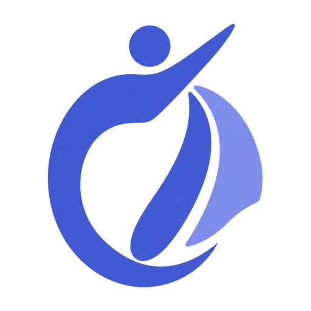
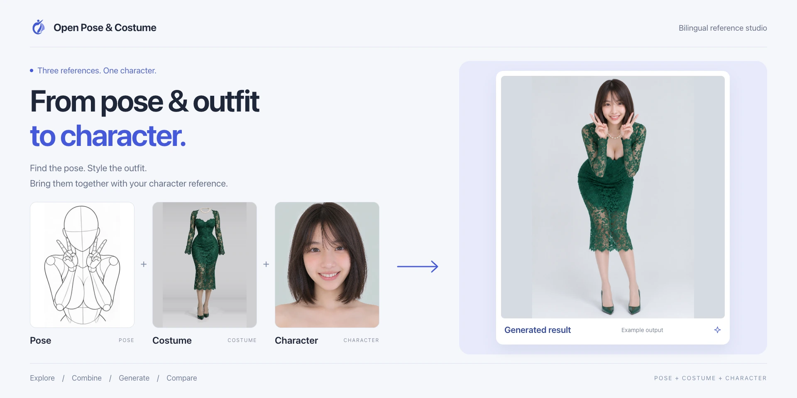
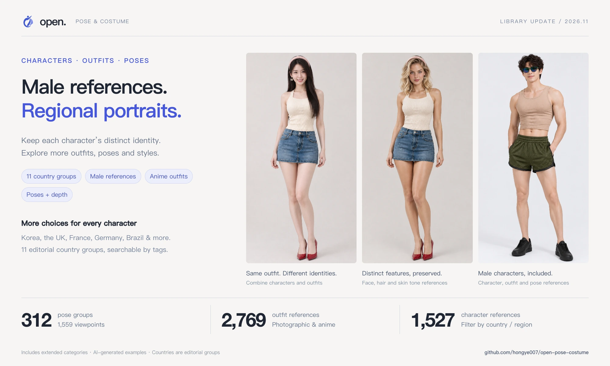
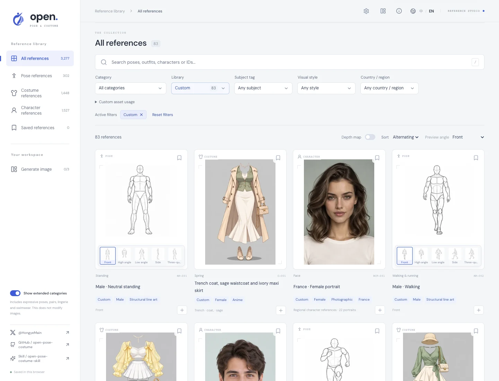
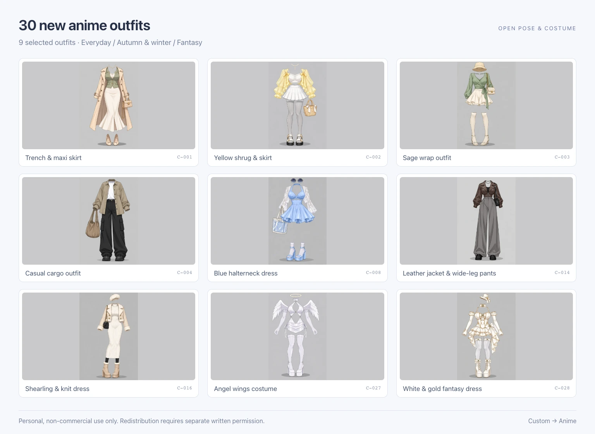
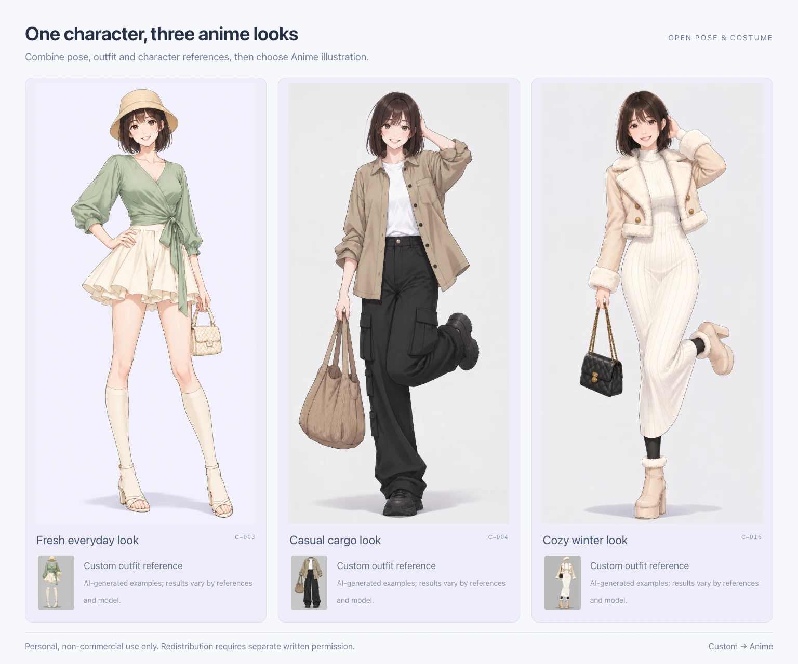
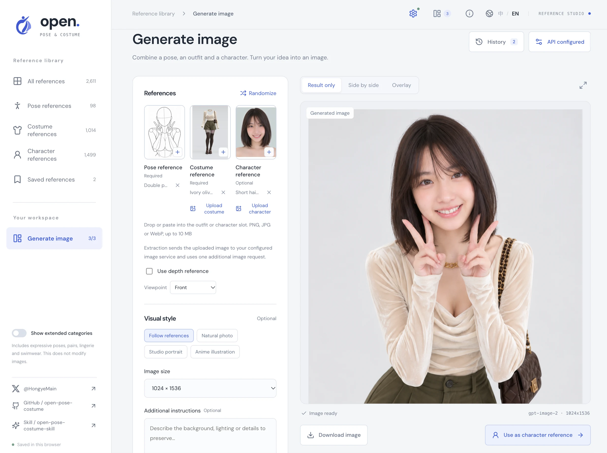
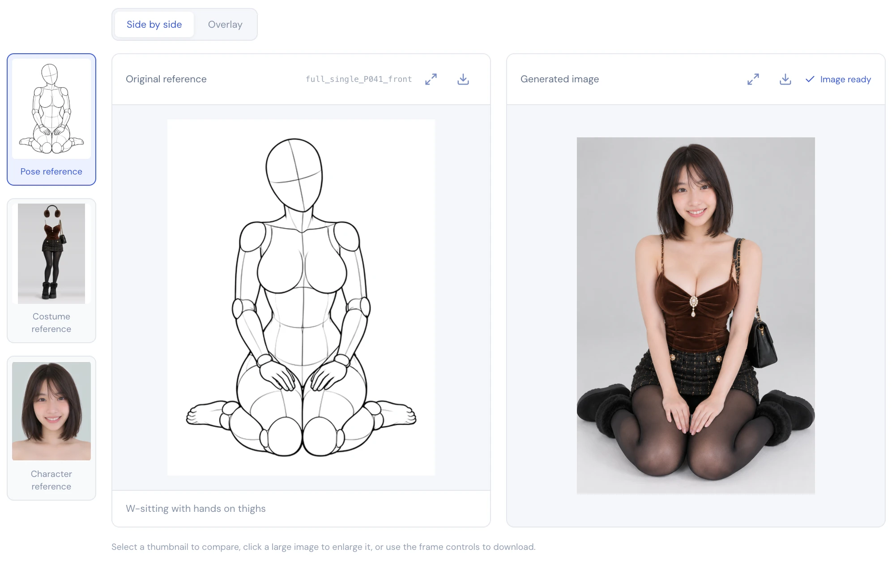
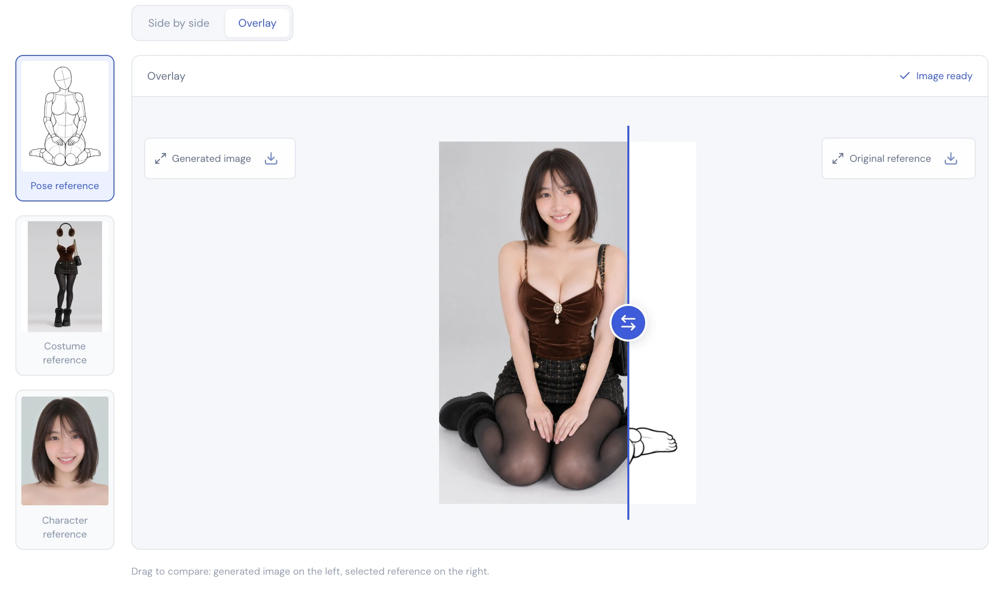

<div align="center">



# Open Pose & Costume

### De la pose y el atuendo al personaje

Un estudio de referencia bilingüe para diseño de personajes, práctica de dibujo y creación con IA.<br />
Encuentra inspiración, combina referencias y genera personajes en un solo lugar.

**[Probar el estudio ↗](https://hongye007.github.io/open-pose-costume/)** &nbsp; · &nbsp; [Skill de generación de personajes](https://github.com/hongye007/open-pose-costume-skill) &nbsp; · &nbsp; [Guía de prueba gratuita](https://my.feishu.cn/wiki/DuwOwjo0oiUrMAkVY8McigKcnsh)

[中文](README.md) / [English](README.en.md) / **Español** &nbsp; · &nbsp; [Autor en X · @HongyeMain](https://x.com/HongyeMain)

</div>



<table align="center">
  <thead>
    <tr>
      <th align="center">Referencias de pose</th>
      <th align="center">Atuendos</th>
      <th align="center">Referencias de personaje</th>
      <th align="center">Imágenes de referencia</th>
    </tr>
  </thead>
  <tbody>
    <tr>
      <td align="center"><strong>312</strong> grupos · <strong>1,559</strong> vistas</td>
      <td align="center"><strong>2,769</strong></td>
      <td align="center"><strong>1,527</strong></td>
      <td align="center"><strong>5,855</strong></td>
    </tr>
  </tbody>
</table>

<div align="center">
<sub>Incluye categorías ampliadas · Atuendos: 1,407 fotográficos + 1,320 anime del upstream + 42 personalizados · El recuento de imágenes excluye los mapas de profundidad emparejados y las copias de vista previa · Actualizado el 2 de noviembre de 2026 (Asia/Shanghai)</sub>
</div>

<p align="center">
<a href="#novedades-atuendos-anime-y-poses-de-modelobaile">Novedades</a> ·
<a href="#explorar-y-guardar">Explorar y guardar</a> ·
<a href="#atuendos-anime-biblioteca-del-upstream-y-colección-personalizada">Atuendos anime</a> ·
<a href="#pose-atuendo-y-personaje-genera-una-imagen">Generar</a> ·
<a href="#skill-complementaria">Skill complementaria</a> ·
<a href="#ejecutar-en-local">Ejecutar en local</a> ·
<a href="#licencia-y-créditos">Licencia</a>
</p>

---

## Novedades: atuendos anime y poses de modelo/baile

- **Atuendos fotográficos y anime**: 1,320 referencias anime del upstream ofrecen versiones anime de los atuendos fotográficos correspondientes en ocho categorías. Con 30 atuendos anime personalizados, la biblioteca ahora tiene **1,350 referencias anime** y **2,769 atuendos en total**. Los estilos fotográfico y anime se pueden filtrar de forma independiente.
- **Poses de modelo y baile**: 10 nuevos grupos de poses femeninas están etiquetados como Model y Dance. Cada uno tiene vistas frontal, alta, baja, lateral y diagonal con mapas de profundidad emparejados: **50 imágenes de dibujo lineal y 50 mapas de profundidad relativa**. Los dibujos de construcción con fondo blanco se pueden buscar tanto en la biblioteca como en el selector de generación.
- **Referencias masculinas**: 13 nuevos grupos de poses masculinas con 65 vistas, 4 atuendos masculinos fotorrealistas con calzado completo y 6 retratos masculinos con diferentes peinados e identidades visuales.
- **Cinco vistas y profundidad emparejada**: cada pose personalizada ofrece vistas frontal, alta, baja, lateral y diagonal. Incluidas 11 poses femeninas, la colección personalizada tiene 24 grupos, 120 imágenes de dibujo lineal y 120 mapas de profundidad relativa inferidos por IA y emparejados. Son guías visuales, no mediciones 3D calibradas.
- **Retratos regionales**: 22 retratos ficticios de adultos en 11 grupos editoriales de países, una mujer y un hombre por grupo. Siete retratos femeninos fueron rediseñados además con un encargo de modelo de moda adulta de 20 años y con estructura facial, ojos, cabello y tonos de piel distintos. Los grupos de países no establecen la nacionalidad ni una apariencia representativa de ninguna población.
- **Más atuendos**: 4 atuendos masculinos y 7 atuendos femeninos extraídos se suman a los 30 atuendos anime existentes y a un atuendo con patrón de luna, con lo que la colección de atuendos personalizados llega a **42**. Las referencias extraídas eliminan a la persona y conservan el volumen de la prenda; las notas de procedencia identifican añadidos como el calzado ausente en la foto original.
- **Mejor descubrimiento**: filtros independientes de categoría, colección, sujeto y estilo visual, además de país/región y largo del cabello para los personajes. Las opciones muestran los recuentos de coincidencias y los filtros activos se pueden eliminar de forma individual. Los selectores de poses tienen cinco miniaturas que cambian solo su propia tarjeta, filtros fijos y carga automática al desplazarse.

[Explorar poses de modelo/baile ↗](https://hongye007.github.io/open-pose-costume/?lang=en&view=pose&collection=custom&tag=dance#collection) · [Explorar poses masculinas ↗](https://hongye007.github.io/open-pose-costume/?lang=en&view=pose&collection=custom&tag=male#collection) · [Explorar atuendos masculinos ↗](https://hongye007.github.io/open-pose-costume/?lang=en&view=costume&collection=custom&tag=male&style=photo#collection) · [Explorar retratos personalizados ↗](https://hongye007.github.io/open-pose-costume/?lang=en&view=character&collection=custom#collection)



## Explorar y guardar

- **Tres bibliotecas, una búsqueda**: explora poses, atuendos y personajes. Busca por nombre en chino o en inglés, palabra clave o ID, y luego acota los resultados con filtros independientes de categoría, colección, sujeto y estilo visual, además de país/región y largo del cabello para los personajes. La ordenación y el punto de vista son ajustes de visualización independientes. Usa la barra lateral o el menú de categorías agrupadas para seleccionar un tipo de referencia en la página de todas las referencias.
- **Ángulos y mapas de profundidad**: cambia los puntos de vista de las poses o previsualiza los mapas de profundidad. Al pasar el cursor o hacer clic en una miniatura de punto de vista, solo cambia esa tarjeta. Las listas usan miniaturas; abre los detalles para ampliar y descargar los originales. Las poses personalizadas usan sus mapas de profundidad emparejados cuando están disponibles; en caso contrario, el dibujo lineal sigue visible con un aviso. Las categorías ampliadas se pueden activar por separado.
- **Favoritos y uso compartido**: guarda referencias y vuelve a “Referencias guardadas” para continuar combinando o descargarlas. Los enlaces compartidos conservan el idioma, los filtros y las referencias seleccionadas.
- **Exploración continua**: diseño adaptable, imágenes con carga diferida y carga automática al desplazarse. Pulsa `/` para buscar, `←` / `→` para navegar en la vista de detalle y `Esc` para cerrarla.



La biblioteca de personajes tiene **1,527 referencias**: 893 referencias de rostros originales, 606 referencias de estilo originales y 28 retratos personalizados de cabeza y hombros. Las poses originales, los atuendos fotográficos y los personajes están etiquetados como Female según lo confirmado por el curador; los atuendos fotográficos y los personajes también llevan la etiqueta Photographic. Los nuevos atuendos anime están etiquetados como Female / Anime, mientras que las referencias masculinas conservan su etiqueta Male. Los personajes admiten filtros de país/región y largo del cabello. El color de ojos, el color de cabello y el tono de piel todavía no tienen filtros estructurados completos, aunque las palabras clave describen algunos retratos personalizados.

## Atuendos anime: biblioteca del upstream y colección personalizada

Los **1,350 atuendos anime** comprenden **1,320 referencias del upstream** de [AI Costume Anime Gallery](https://ai-costume-anime-gallery.pages.dev/) y **30 atuendos personalizados**. Los elementos del upstream comparten los ID de origen con los atuendos fotográficos correspondientes y ofrecen, principalmente, versiones anime de los mismos diseños. Los códigos `ANIME-` separados mantienen distintos los favoritos y las referencias seleccionadas.

La colección del upstream conserva ocho categorías: primavera, verano, otoño, invierno, lencería, fiesta, trajes de baño y atuendos llamativos. Muestra 932 atuendos de forma predeterminada; activa las categorías ampliadas para acceder a los 1,320. Establece el estilo visual en Anime y luego elige Original library o Custom para filtrar por origen. Busca por términos de prendas en chino o en inglés, color, material o código.

### 30 atuendos anime personalizados

Los atuendos anime personalizados abarcan looks cotidianos, capas de otoño e invierno y trajes de fantasía. La imagen siguiente muestra nueve de ellos. Estos 30 atuendos y 12 atuendos fotográficos conforman **42 atuendos personalizados**. Ambas fuentes anime funcionan en el estudio de generación; elige **Anime illustration** como estilo de salida cuando corresponda.



### Crear un personaje con atuendos anime

1. **Encuentra un atuendo**: en la biblioteca de atuendos o en el selector de atuendos del estudio, establece **Visual style → Anime**. Elige **Original library** para los atuendos anime del upstream o **Custom** para los 30 atuendos anime personalizados. Activa las categorías ampliadas para lencería, trajes de baño y atuendos llamativos.
2. **Combina referencias**: elige una pose y un atuendo y, opcionalmente, selecciona o sube una referencia de personaje para orientar los rasgos faciales, el peinado y la identidad.
3. **Elige el estilo y genera**: selecciona **Anime illustration** en el estilo visual, ajusta el tamaño, el fondo o las instrucciones adicionales, y genera después de configurar el servicio de imágenes. Los cargos dependen de ese servicio.

[Explorar atuendos anime del upstream ↗](https://hongye007.github.io/open-pose-costume/?lang=en&view=costume&collection=builtin&style=anime#collection) · [Explorar los 30 atuendos anime personalizados ↗](https://hongye007.github.io/open-pose-costume/?lang=en&view=costume&collection=custom&style=anime&extended=1#collection)



Estos son ejemplos generados por IA con atuendos personalizados; los resultados dependen de las referencias, los prompts y el modelo. Los atuendos personalizados se reconstruyen o se extraen de referencias con IA. Cada uno incluye un PNG de 1024 × 1536, una vista previa WebP y una miniatura. Las vistas previas y los originales del upstream anime se cargan bajo demanda desde el sitio de origen. Las poses y los retratos personalizados también están disponibles en sus propios manifiestos; consulta [novedades](#novedades-atuendos-anime-y-poses-de-modelobaile).

**Los recursos personalizados son gratuitos para aprendizaje personal y uso no comercial. El uso comercial está prohibido; cualquier distribución, redistribución o reventa requiere un permiso previo por escrito y por separado.** Consulta los [términos de los recursos personalizados](public/custom/LICENSE.txt) y contacta a [@HongyeMain](https://x.com/HongyeMain) para obtener permiso.

## Pose, atuendo y personaje. Genera una imagen.

Abre “Generate image” desde la barra lateral. Elige referencias y ajustes a la izquierda y luego consulta el resultado a la derecha. **Se requieren una pose y un atuendo; la referencia de personaje es opcional.** La pose orienta la acción, el atuendo orienta la vestimenta y la referencia de personaje ayuda a preservar la identidad y la apariencia. Elige referencias de la biblioteca o haz clic en “Randomize” para inspirarte.



### De las referencias a una imagen

1. **Configura el servicio**: haz clic en “Configure image service” o en el icono de ajustes en la esquina superior derecha, y luego introduce la URL del servicio, la clave API y el modelo. La generación está deshabilitada hasta que se configure la API.
2. **Elige referencias**: selecciona una pose y un atuendo y, opcionalmente, elige un personaje de la biblioteca o sube uno propio. Sube, arrastra o pega imágenes PNG, JPG o WebP de hasta 10 MB cada una.
3. **Extrae tu propio atuendo**: “Upload costume” abre un cuadro de diálogo. Elige una foto de atuendo a la izquierda, haz clic en “Extract outfit” en el centro, revisa el resultado a la derecha y luego en “Confirm and use”. La extracción realiza una solicitud de imagen adicional. Se pueden reintentar los fallos; la referencia anterior se mantiene hasta confirmar.
4. **Ajusta y genera**: haz clic en una miniatura pequeña de punto de vista en el selector de poses para cambiar solo esa tarjeta, y luego haz clic en su imagen principal para seleccionarla. Selecciona un punto de vista, activa opcionalmente la orientación por profundidad y establece el estilo visual (Follow references, Natural photo, Studio portrait o Anime illustration), el tamaño de la imagen y las instrucciones adicionales. Los ajustes avanzados permiten editar el prompt completo. Haz clic en “Generate image”; puedes seguir explorando mientras se ejecuta y reintentar manualmente las solicitudes fallidas.
5. **Revisa y sigue creando**: cambia entre “Result only”, “Side by side” y “Overlay”, amplía o descarga el resultado, o selecciona “Use as character reference”. El panel “History” conserva los últimos 20 resultados exitosos, con controles para restaurar referencias, eliminar registros y descargar un ZIP de la pose, el atuendo y las referencias de personaje opcionales usadas para ese resultado.

| Ajuste             | Valor predeterminado o requisito                                                                                       |
| ------------------ | ---------------------------------------------------------------------------------------------------------------------- |
| Service URL        | `https://atomflow.vip`, editable                                                                                       |
| Model              | `gpt-image-2`, editable                                                                                                |
| Endpoint           | `POST /v1/images/edits`, formato multipart compatible con OpenAI                                                       |
| Reference images   | Dos originales (pose y atuendo), o tres con un personaje opcional, subidos como `image[]`                               |
| Browser access     | Las solicitudes locales a Atomflow usan Vite; en producción se puede usar el proxy Worker restringido; los servicios personalizados deben proporcionar CORS |

<details>
<summary>¿Cómo se almacenan las claves API, las imágenes y el historial?</summary>

Los ajustes se quedan en tu navegador. La clave API se almacena solo para la sesión actual de forma predeterminada; activar “Remember key” la almacena en local. Puedes borrarla en los ajustes. Durante la generación, las referencias y la descripción se envían a tu servicio configurado, que puede cobrar por el uso. Las solicitudes locales a Atomflow pasan por Vite; las solicitudes en producción pasan por el Worker restringido cuando está configurado. El Worker no almacena claves ni imágenes. Las claves están excluidas de los enlaces compartidos y del repositorio.

Las selecciones de la biblioteca se guardan como ID de referencia en este navegador. Las listas usan miniaturas. Los detalles personalizados usan vistas previas WebP; la generación y las descargas de originales usan PNG de alta resolución. Las entradas de la biblioteca original usan las vistas previas y los originales especificados en el índice. Para los atuendos subidos, la foto original se envía a tu servicio configurado cuando haces clic en “Extract outfit”. La extracción confirmada se convierte en la referencia de atuendo para la generación posterior.

El historial se almacena en este navegador con IndexedDB, incluidas las imágenes generadas, los prompts, los ajustes y la información de referencia. Los archivos de referencia subidos también se guardan con los resultados exitosos. Las subidas sin un resultado exitoso se quedan solo en la memoria de la página. Elimina registros individuales o borra el historial en el panel. El sitio web no escribe automáticamente las imágenes subidas, los resultados generados ni las claves en los enlaces compartidos ni en el repositorio; el historial no contiene claves API.

</details>

### Lado a lado

Consulta la referencia seleccionada junto al resultado generado para comparar la pose y el atuendo.



### Superposición

Arrastra el divisor dentro de un solo marco, con la imagen generada a la izquierda y la referencia seleccionada a la derecha. Se admiten las teclas de flecha y Home / End. Si los tamaños o las posiciones de los sujetos difieren, selecciona “Align images” para acercar y arrastrar cada imagen antes de comparar. La alineación afecta solo a la vista previa y deja intactos los originales y las descargas.



Estos son resultados de ejemplo. Los resultados dependen del modelo, la descripción y la configuración del servicio.

## Skill complementaria

[open-pose-costume-skill](https://github.com/hongye007/open-pose-costume-skill) combina referencias de pose, atuendo y personaje en una sola imagen de personaje mediante solicitudes en lenguaje natural en Codex. Explora y selecciona referencias en este sitio web y luego usa la skill para generar un personaje. Consulta el README bilingüe del repositorio de la skill para la instalación, los ejemplos y la configuración del servicio de imágenes.

## Ejecutar en local

Requiere **Node.js 22.12+**.

```sh
npm ci
npm run dev
```

Abre <http://127.0.0.1:5199>. La comprobación estricta de puertos está activada, así que el inicio termina si el puerto está ocupado. Comprueba la disponibilidad antes de iniciar o elige otro puerto libre:

```sh
npm run dev -- --port 5200
```

Comprueba con `lsof -nP -iTCP:5200 -sTCP:LISTEN` en macOS/Linux, o con `Get-NetTCPConnection -LocalPort 5200` en Windows PowerShell.

Durante `npm run dev`, Vite reenvía las solicitudes de Atomflow `/v1/images/edits` a través del origen local al host configurado `atomflow.vip` o `api.atomflow.vip`, lo que evita las restricciones CORS del navegador. La clave se reenvía solo con la solicitud actual. Las URL de servicios personalizados siguen conectándose directamente y deben permitir solicitudes CORS con el encabezado `Authorization`.

## Compilación y despliegue

El sitio se despliega en [GitHub Pages](https://hongye007.github.io/open-pose-costume/). Los pushes a `main` ejecutan automáticamente pruebas, compilan con `/open-pose-costume/` como ruta base y despliegan mediante GitHub Actions. Las pruebas o compilaciones fallidas impiden el despliegue. Las demás ramas y los pull requests solo ejecutan comprobaciones.

La generación en producción para móviles usa el Cloudflare Worker en `worker/`. Solo acepta los orígenes de este sitio, reenvía únicamente los dos endpoints fijos de edición de imágenes de Atomflow y transmite las respuestas sin almacenar claves API ni imágenes. No puede actuar como proxy de URL arbitrarias. Despliégalo y valídalo con:

```sh
npm run worker:check
npm run worker:deploy
```

Después del despliegue, establece la variable de repositorio de GitHub Actions `IMAGE_PROXY_URL` con la URL raíz del Worker; este proyecto usa actualmente `https://open-pose-costume-image-proxy.hongye1main.workers.dev`. Actions la expone a la compilación como `VITE_IMAGE_PROXY_URL`. Sin esta variable, la producción vuelve a las solicitudes directas del navegador a Atomflow; las URL de servicios personalizados siempre siguen siendo directas.

CI usa un checkout disperso para omitir los archivos de imágenes del upstream en la raíz del repositorio, `pose/` y `costume/`. Las imágenes personalizadas en `public/custom/` se incluyen en el checkout, se incluyen en las compilaciones y se despliegan con el sitio web.

Compilado con **React 19 · TypeScript · Vite · Lucide**. La biblioteca de referencias es un sitio web estático; la generación de imágenes requiere tu propia configuración de servicio.

```sh
npm run build
```

Despliega `dist/` en un host estático. Para Cloudflare Pages, usa `npm run build` como comando de compilación y `dist` como directorio de salida. `public/_headers` proporciona encabezados de caché y seguridad en Cloudflare Pages; GitHub Pages no lee este archivo.

Elige también un puerto libre para la vista previa en local:

```sh
npm run preview -- --port 5200
```

## Datos y mantenimiento

Los metadatos anime se almacenan por separado en `data/source/costume-anime.json` y se fusionan con los atuendos fotográficos al reconstruir el índice. Ejecuta `npm run sync -- --costume-anime-only` para actualizar esta fuente y conservar las demás instantáneas y los manifiestos personalizados. Las imágenes anime del upstream están excluidas del comando de archivo masivo.

Las imágenes de la biblioteca original conservan sus URL del upstream, así que su disponibilidad depende de los sitios de origen. Los archivos locales en la raíz no cambian esas URL. Las imágenes personalizadas se compilan y se despliegan desde `public/custom/` y las sirve este sitio web.

Los metadatos de personajes provienen de [AI Portrait Gallery](https://ai-portrait-gallery.pages.dev/). Las miniaturas y los originales de los retratos no se descargan ni se archivan en este repositorio y están excluidos de `images:download`.

| Comando                 | Propósito                                                                                                                   |
| ----------------------- | --------------------------------------------------------------------------------------------------------------------------- |
| `npm run sync`          | Sincronizar los metadatos del upstream sin ejecutar código de páginas del upstream ni descargar imágenes                   |
| `npm run data:build`    | Reconstruir el índice a partir de las instantáneas locales del upstream y los manifiestos personalizados                    |
| `npm test`              | Ejecutar pruebas                                                                                                            |
| `npm run build`         | Comprobar los tipos y compilar el sitio web                                                                                 |
| `npm run images:download` | Opcional: archivar las portadas y los originales de poses/atuendos del upstream; excluye retratos, imágenes anime del upstream y recursos personalizados |

Las instantáneas de metadatos están en `data/source/`, el índice del sitio web en `public/data/catalog.json` y los registros de sincronización en `data/sync-manifest.json`. La sincronización comprueba categorías, ángulos y cobertura de traducción. Si faltan traducciones, actualiza los diccionarios indicados por el error.

Las extensiones personalizadas se mantienen en [`data/custom/`](data/custom/README.md), por separado de las instantáneas del upstream en `data/source/`. Los atuendos, las poses y los personajes usan `costume.json`, `pose.json` y `character.json`, respectivamente. Las imágenes están en `public/custom/{costume,pose,character}/{originals,images,thumbnails}/`. Tanto las reconstrucciones del índice como la sincronización del upstream fusionan las entradas personalizadas y recalculan los recuentos sin sobrescribir estos manifiestos. Consulta la [guía de extensiones personalizadas](data/custom/README.md) para añadir referencias y procedencia por lotes.

<details>
<summary>Archivos de imágenes y recursos de marca</summary>

Los archivos de poses y atuendos del upstream conservan todos los ángulos de pose disponibles, con un total de 5,692 archivos. Los recursos personalizados son independientes:

```text
pose/
  covers/       # 1,439 miniaturas JPG
  originals/    # 1,439 originales PNG
costume/
  covers/       # 1,407 miniaturas WebP
  originals/    # 1,407 originales PNG
```

Las portadas y los originales se controlan en Git, con un total aproximado de 1.95 GiB. Los archivos están excluidos de las compilaciones del sitio; el sitio web sigue usando las URL de imágenes del upstream. El mantenedor confirma un permiso adicional del creador original para la redistribución pública en este repositorio. Las imágenes no están cubiertas por la licencia MIT del código; consulta [SOURCES.md](SOURCES.md).

Las descargas admiten verificación SHA-256, reintentos y reutilización de archivos existentes. La concurrencia predeterminada es 8; ajústala con `npm run images:download -- --concurrency 4`. El manifiesto y el resumen se escriben en `data/image-download-manifest.json` y `data/image-download-summary.json`. Los registros de descarga siguen ignorados por Git.

Consulta el [logotipo original](output/imagegen/open-pose-costume-logo-original.png) y el [prompt de generación](assets/brand/logo-prompt.txt). Con Python Pillow y NumPy instalados, ejecuta `python3 scripts/build-brand-assets.py` para generar la marca transparente, el favicon y el icono táctil de Apple.

</details>

## Licencia y créditos

La fuente de retratos declara [CC0 1.0](https://creativecommons.org/publicdomain/zero/1.0/) y, al mismo tiempo, solicita que no se republican ni redistribuyan los datos de imagen. Los retratos representan personas ficticias generadas por IA. Ambas afirmaciones están registradas en [SOURCES.md](SOURCES.md).

El código y los permisos de las imágenes son independientes:

| Contenido                                                      | Licencia y uso permitido                                                                                                                                                                                                                                                     |
| -------------------------------------------------------------- | ------------------------------------------------------------------------------------------------------------------------------------------------------------------------------------------------------------------------------------------------------------------------------ |
| Código del proyecto                                            | [Licencia MIT](LICENSE)                                                                                                                                                                                                                                                        |
| Poses y atuendos de la biblioteca original                     | Los términos de origen permiten la referencia, la edición y la producción de trabajos comerciales, pero prohíben la redistribución, la republicación o la reventa de los datos de imagen, incluidas las copias editadas. El permiso del mantenedor para archivarlos en este repositorio no se transfiere automáticamente a los usuarios. |
| Recursos personalizados, ediciones y derivados generados       | Gratuitos para aprendizaje personal y uso no comercial. El uso comercial está prohibido. La distribución, la redistribución, la republicación, el empaquetado, la provisión de descargas o la reventa requieren un permiso previo por escrito y por separado. Consulta los [términos de los recursos personalizados](public/custom/LICENSE.txt). |
| Fuentes de retratos, datos del upstream y traducciones de terceros | Se aplican sus respectivos términos; consulta [SOURCES.md](SOURCES.md) y [THIRD_PARTY_NOTICES.md](THIRD_PARTY_NOTICES.md).                                                                                                                                                       |

Las imágenes no están licenciadas bajo los términos MIT del código. Contacta a [@HongyeMain](https://x.com/HongyeMain) para obtener permiso sobre los recursos personalizados.

Gracias al creador original de poses y atuendos y a los colaboradores de la traducción al chino.

## Versión en español (rama es)

Esta traducción vive en la rama `es` del fork [gilberth/open-pose-costume](https://github.com/gilberth/open-pose-costume). La demo pública del autor original sigue siendo zh/en.

Para usar la versión en español, clona esta rama y ejecuta:

```sh
git clone -b es https://github.com/gilberth/open-pose-costume.git
cd open-pose-costume
npm ci && npm run dev
```

Para mantener esta traducción frente a actualizaciones del upstream, consulta [docs/ES-UPDATES.md](docs/ES-UPDATES.md).
