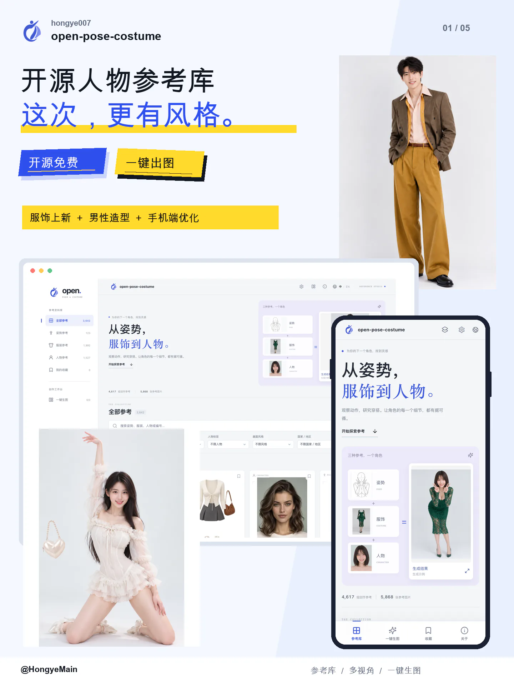
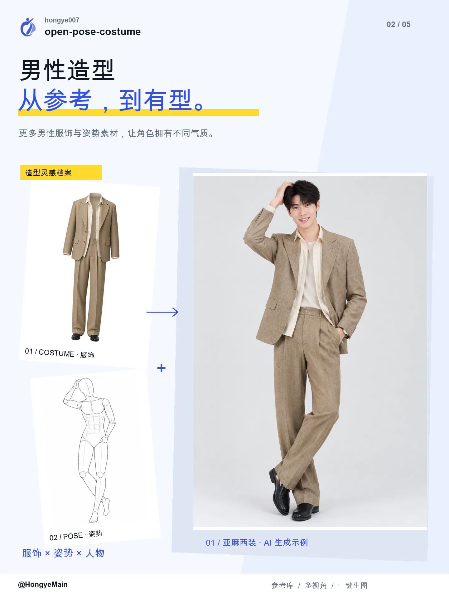

<div align="center">


# Open Pose & Costume

### 找姿势、配服饰、选人物，一键生成完整角色

面向角色设计、绘画练习与 AI 创作的中英文参考工作台。

**[在线体验](https://omilic.com/)** · [版本发布](https://github.com/hongye007/open-pose-costume/releases) · [人物生成 Skill](https://github.com/hongye007/open-pose-costume-skill) · [English](README.en.md) · [作者 X](https://x.com/HongyeMain)

</div>


<div align="center">

| 姿势 | 服饰 | 人物 | 图片总数 |
| :---: | :---: | :---: | :---: |
| **343 组** · 1,714 个视角 | **2,801 套** | **1,538 张** | **6,053 张** |

<sub>数据来自当前 <code>public/data/catalog.json</code>，不重复计算预览副本</sub>

</div>

## 亮点

- **三类参考，一处完成**：搜索姿势、服饰与人物，组合后直接生成角色。
- **丰富且可筛选**：支持中英文搜索、编号检索、分类、来源、性别、画面风格、国家／地区和发长筛选。
- **多视角与深度参考**：姿势支持正面、俯视、仰视、侧面和斜侧；部分自建姿势附 AI 推断的相对深度图。
- **写实与动漫服饰**：当前包含 1,451 套写实服饰和 1,350 套动漫服饰，可按来源与风格筛选。
- **两种生图方案**：OpenWego 免费生成，或 Atomflow 高质量生成；自定义 OpenAI 兼容 URL、密钥和模型。
- **完整创作闭环**：支持上传人物与服饰、提取服饰、随机搭配、双列／叠加对比、结果下载和最近 20 次历史记录。
- **本地优先**：收藏、配置和生成历史保存在当前浏览器；密钥不会写入分享链接或仓库。

## 最近更新

- 新增 **OpenWego 免费生图**，默认模型为 `open-image-v2`：游客每天 20 张，登录用户无限用（免费）；无密钥请求按 IP 计算游客额度。
- Atomflow 默认升级为 `gpt-image-2.6-sunburst`，定位高质量生成，同时保留自定义服务 URL、API Key 和模型的能力。
- 优化手机端使用体验，小屏下的服务配置、参考选择与生成结果预览更加紧凑顺畅。
- 素材库更新至 **343 组姿势、2,801 套服饰、1,538 张人物参考**，包含男性、女性、写实、动漫、舞蹈与多地区虚构人物素材。

<p align="center">
  
  
</p>

## 使用方法

### 1. 查找参考

从姿势、服饰或人物库开始，通过搜索和筛选快速定位素材。姿势卡片可独立切换视角与深度图；收藏会保存在当前浏览器。


### 2. 组合参考

进入“一键生图”，选择 **姿势 + 服饰**，人物参考可选。也可以上传或粘贴 PNG、JPG、WebP 图片，单张最大 10 MB；上传服饰后可先提取衣物再参与生成。

### 3. 选择服务并生成

| 方案 | 适合场景 | 配置 |
| --- | --- | --- |
| **OpenWego 免费生成** | 日常创作、内容限制较少 | 默认 `open-image-v2`；API Key 可选；非旗舰级模型 |
| **自定义兼容接口** | 使用自己的服务 | 在 Atomflow 方案中修改 URL、API Key 与模型；需兼容 `/v1/images/edits` |

生成前可选择观察角度、画面风格和补充描述；尺寸与质量默认使用推荐参数。生成后可切换“仅结果”“双列预览”与“叠加预览”，也可以调整对齐、换个姿势、下载图片或恢复历史搭配。


> 特别感谢 [OpenWego](https://openwego.com/) 提供免费 API。OpenWego 还提供图片反推提示词、提示词优化、风格提取等免费工具。

## 生图与隐私

- OpenWego 请求由浏览器直连；无密钥时不会发送 `Authorization` 请求头。
- 默认 Atomflow 请求在本地通过 Vite 转发，线上可通过受限 Cloudflare Worker 转发；自定义兼容接口由浏览器直连并需要正确的 CORS 配置。
- API Key 默认保存在当前浏览器的本地存储；取消“记住密钥”后只保留在当前会话，可随时清除。
- 生成或提取服饰时，所选参考图与描述会发送到当前配置的服务；服务费用、额度与审查规则以服务方为准。
- 生成历史通过 IndexedDB 保存在本地，最多展示最近 20 次成功结果，不包含 API Key。

## 配套 Skill

[open-pose-costume-skill](https://github.com/hongye007/open-pose-costume-skill) 可在 Codex 中通过自然语言组合姿势、服饰与人物参考。网站适合浏览和选图，Skill 适合执行自动化创作流程。

## 本地运行

需要 **Node.js 22.12+**。

```sh
npm ci
npm run dev
```

默认地址：<http://127.0.0.1:5199>

项目启用严格端口检查。若 5199 已被占用，请先检查端口或选择其他空闲端口：

```sh
lsof -nP -iTCP:5199 -sTCP:LISTEN
npm run dev -- --port 5200
```

常用命令：

| 命令 | 用途 |
| --- | --- |
| `npm test` | 运行测试 |
| `npm run build` | 类型检查并构建生产版本 |
| `npm run preview -- --port 5200` | 本地预览生产构建 |
| `npm run sync` | 同步上游元数据 |
| `npm run data:build` | 从快照与自建清单重建索引 |
| `npm run images:download` | 可选：归档部分上游姿势与服饰原图 |

技术栈：**React 19 · TypeScript · Vite · Lucide**。

## 构建与部署

```sh
npm run build
```

将 `dist/` 部署到任意静态托管平台即可。正式站点为 [omilic.com](https://omilic.com/)，GitHub Pages 作为备用部署。

Atomflow 线上代理位于 `worker/`，只接受允许的站点来源并转发固定 Atomflow 图片编辑端点，不保存密钥或图片：

```sh
npm run worker:check
npm run worker:deploy
```

部署后可通过 `VITE_IMAGE_PROXY_URL` 配置 Worker 地址；未配置时会回退为浏览器直连。自定义兼容接口始终由浏览器直连。

## 数据与来源

- 当前索引：`public/data/catalog.json`
- 上游快照：`data/source/`
- 自建清单：`data/custom/`
- 同步记录：`data/sync-manifest.json`
- 自建图片：`public/custom/{pose,costume,character}/`

当前素材由上游图库与自建扩展共同组成：55 组自建姿势、74 套自建服饰和 39 张自建人物，其余来自姿势、服饰、动漫服饰与人物上游图库。完整来源、同步方式和第三方说明见 [SOURCES.md](SOURCES.md)、[THIRD_PARTY_NOTICES.md](THIRD_PARTY_NOTICES.md) 与 [自建扩展说明](data/custom/README.md)。

深度图为 AI 推断的相对深度参考，仅用于视觉引导，不代表精确三维测量。

## 授权

| 内容 | 许可与使用范围 |
| --- | --- |
| 项目代码 | [MIT 许可](LICENSE) |
| 原有姿势、服饰素材 | 可按原站条款用于作品参考、编辑及商用；禁止图片数据本身及其加工版本的再分发、转载和转售 |
| 自建素材及其衍生图 | 免费用于个人学习和非商业用途；商用、分发、转载、打包或转售需单独书面授权，见 [自建素材使用条款](public/custom/LICENSE.txt) |
| 人物与其他第三方素材 | 遵循各自来源条款，详见 [SOURCES.md](SOURCES.md) 和 [THIRD_PARTY_NOTICES.md](THIRD_PARTY_NOTICES.md) |

**图片不随代码按 MIT 授权。** 自建素材授权请联系 [@HongyeMain](https://x.com/HongyeMain)。
