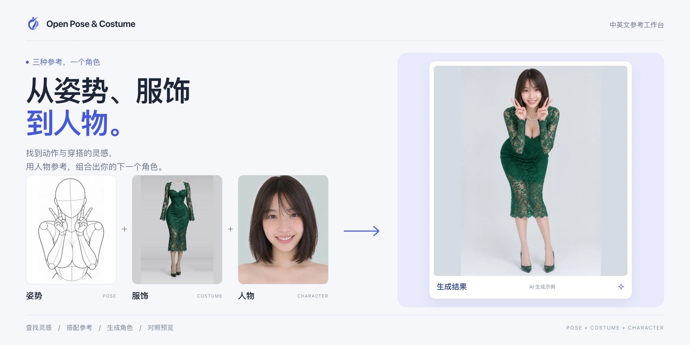
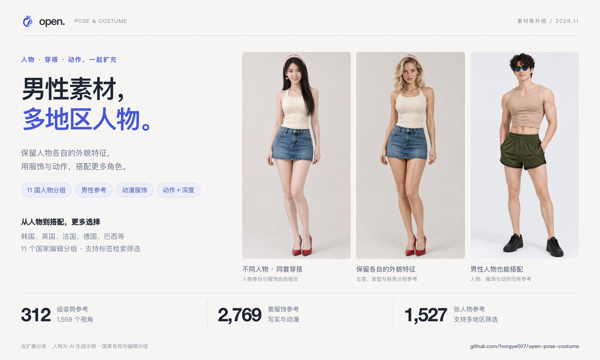
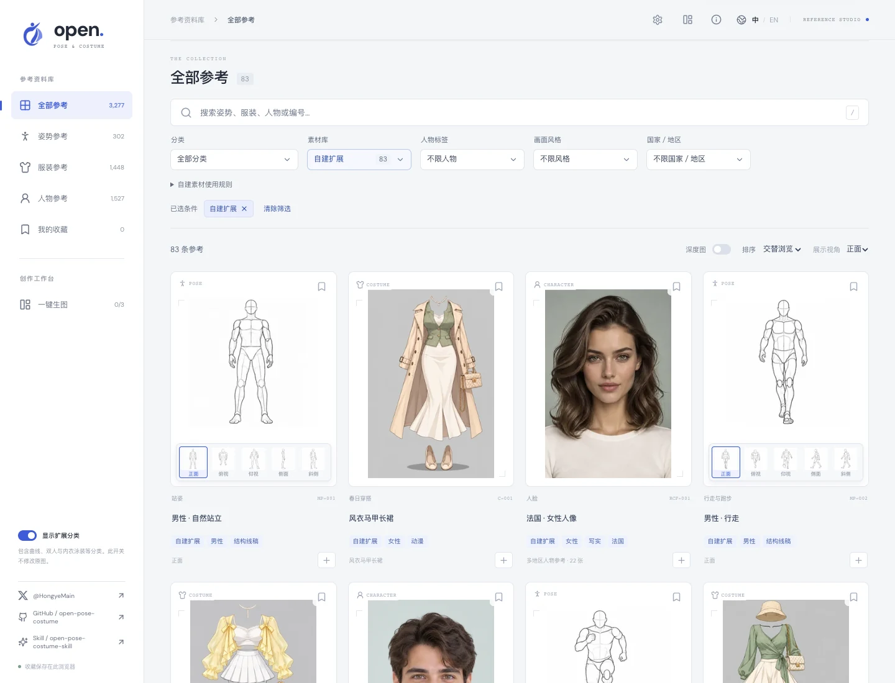
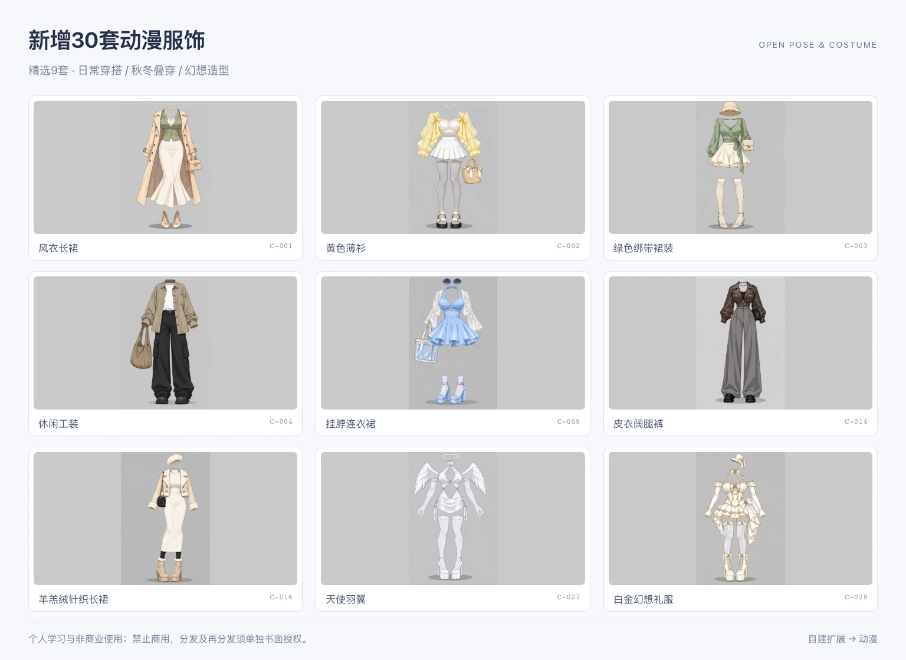
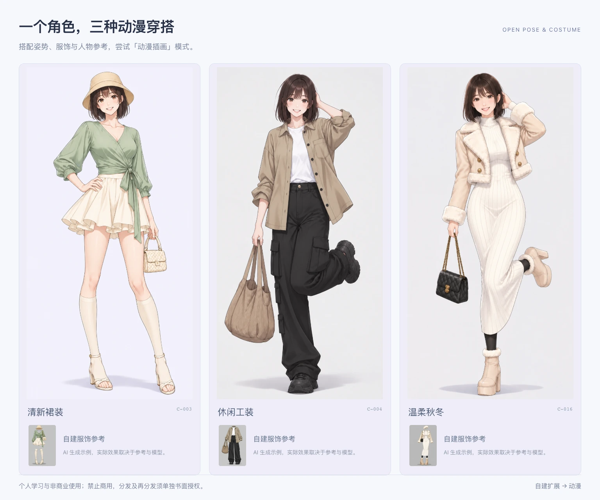
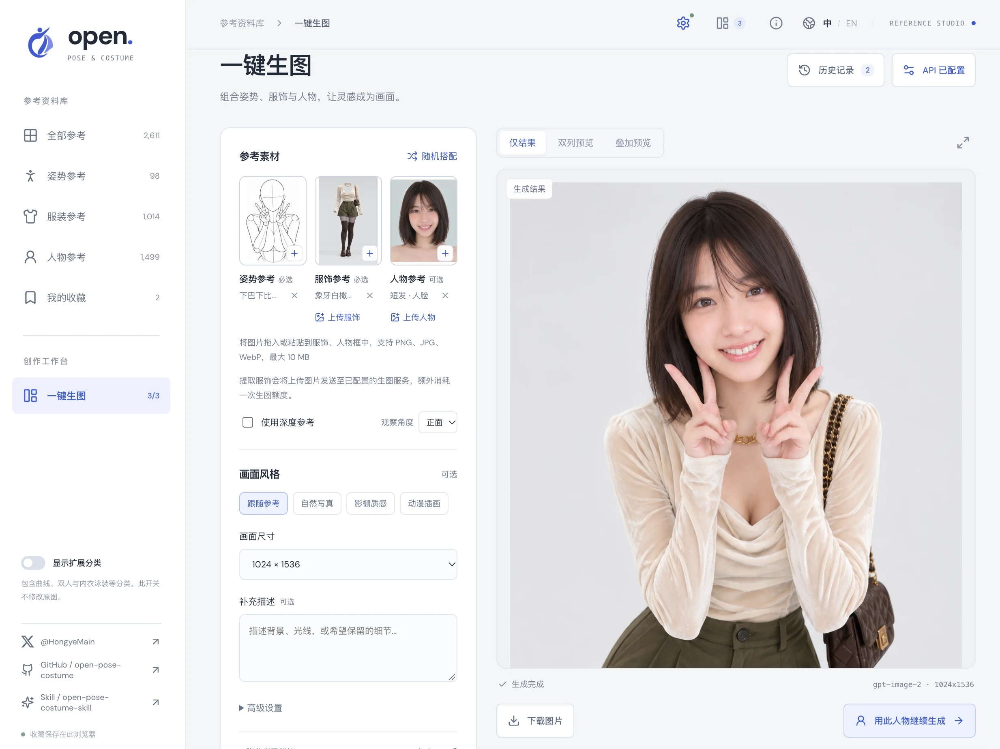
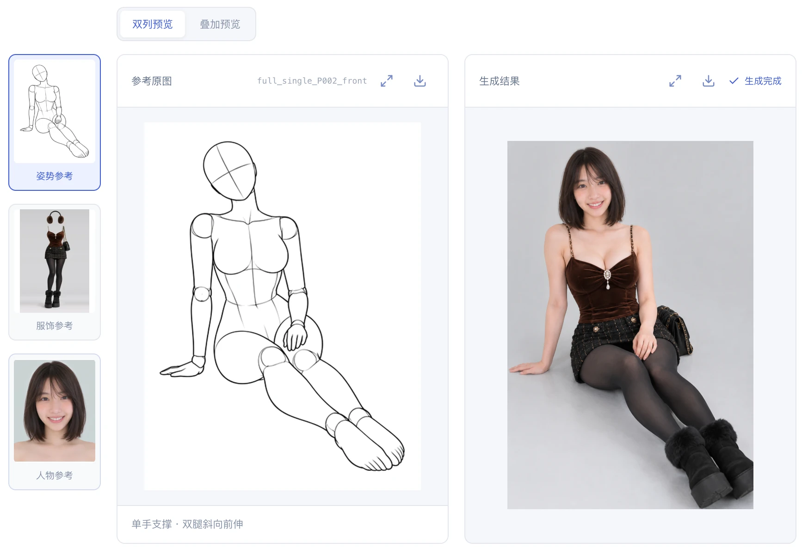
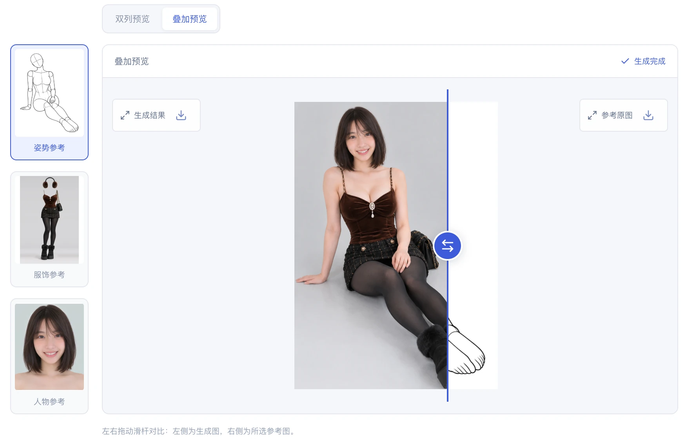

<div align="center">


# Open Pose & Costume

### 从姿势、服饰到人物

为角色设计、绘画练习与 AI 创作准备的中英文参考工作台。<br />
查找灵感、组合参考、生成角色，在一个地方完成。

**[在线体验 ↗](https://hongye007.github.io/open-pose-costume/)** &nbsp; · &nbsp; [人物生成 Skill](https://github.com/hongye007/open-pose-costume-skill) &nbsp; · &nbsp; [免费试用指南](https://my.feishu.cn/wiki/DuwOwjo0oiUrMAkVY8McigKcnsh)

**中文** / [English](README.en.md) &nbsp; · &nbsp; [作者 X · @HongyeMain](https://x.com/HongyeMain)

</div>



<table align="center">
  <thead>
    <tr>
      <th align="center">姿势参考</th>
      <th align="center">服饰参考</th>
      <th align="center">人物参考</th>
      <th align="center">参考图片总数</th>
    </tr>
  </thead>
  <tbody>
    <tr>
      <td align="center"><strong>312</strong> 组 · <strong>1,559</strong> 个视角</td>
      <td align="center"><strong>2,769</strong> 套</td>
      <td align="center"><strong>1,527</strong> 张</td>
      <td align="center"><strong>5,855</strong> 张</td>
    </tr>
  </tbody>
</table>

<div align="center">
<sub>包含扩展分类 · 服饰含 1,407 套写实素材、1,320 套上游动漫素材与 42 套自建素材 · 图片数按视角统计，不含配套深度图及预览副本 · 更新于 2026-11-02（Asia/Shanghai）</sub>
</div>

<p align="center">
<a href="#本次更新动漫服饰与模特舞蹈姿势">本次更新</a> ·
<a href="#查找与收藏">查找与收藏</a> ·
<a href="#动漫服饰上游图库与自建扩展">动漫服饰</a> ·
<a href="#姿势服饰与人物一键生成">一键生图</a> ·
<a href="#配套-skill">配套 Skill</a> ·
<a href="#本地运行">本地运行</a> ·
<a href="#授权与致谢">授权说明</a>
</p>

---

## 本次更新：动漫服饰与模特舞蹈姿势

- **写实与动漫穿搭**：接入 1,320 套上游动漫服饰，覆盖原写实服饰的对应动漫版本，保留四季、派对等 8 个分类。加上 30 套自建动漫服饰，现有 **1,350 套动漫参考**；全部服饰合计 **2,769 套**，可按「写实／动漫」分别筛选。
- **模特与舞蹈动作**：新增 10 组女性姿势，统一标注「模特」「舞蹈」，每组提供正面、俯视、仰视、侧面、斜侧及配套深度图，共 **50 张线稿＋50 张相对深度图**。保留白底结构线稿风格，可在图库和一键生图选图器中检索。
- **男性创作参考**：新增 13 组男性姿势，共 65 个视角；4 套男性写实服饰，均包含完整鞋履；另有 6 张不同发型与气质的男性人物参考。
- **五视角与深度图**：每组自建姿势提供正面、俯视、仰视、侧面、斜侧。加上 11 组女性姿势，自建姿势共 24 组、120 张线稿，并配有 120 张 AI 推断的相对深度图。深度图是视觉引导，非标定三维测量数据。
- **多地区人物**：新增 22 张虚构成年人物，分为 11 个国家编辑组，每组一男一女；7 张女性人像进一步按 20 岁成年模特设定重制，区分脸型、眉眼、发型与肤色。国家／地区仅为目录分组，不代表真实国籍或某个人群的典型外貌。
- **服饰库扩充**：在 30 套动漫服饰和 1 套月纹服饰基础上，加入 4 套男性服饰与 7 套女性提取服饰，自建服饰共 **42 套**。提取图去除人物、保留衣物立体形态；原图未展示的鞋履等补全部分在素材溯源中注明。
- **筛选与选图体验**：分类、素材库、人物标签、画面风格分别筛选；人物增加国家／地区与发长。筛选项显示匹配数量，已选条件可单独移除。姿势选图弹窗支持五个小缩略图独立切换，顶部筛选常驻，列表自动加载更多。

[浏览模特舞蹈姿势 ↗](https://hongye007.github.io/open-pose-costume/?lang=zh&view=pose&collection=custom&tag=dance#collection) · [浏览男性姿势 ↗](https://hongye007.github.io/open-pose-costume/?lang=zh&view=pose&collection=custom&tag=male#collection) · [浏览男性服饰 ↗](https://hongye007.github.io/open-pose-costume/?lang=zh&view=costume&collection=custom&tag=male&style=photo#collection) · [浏览自建人物 ↗](https://hongye007.github.io/open-pose-costume/?lang=zh&view=character&collection=custom#collection)



## 查找与收藏

- **三类参考，一处查找**：浏览姿势、服饰与人物，按中英文名称、关键词或编号搜索，配合分类、素材库、人物标签、画面风格，以及人物专用的国家／地区与发长筛选定位素材。排序与展示视角独立于筛选；全部参考页通过侧栏或分组分类菜单定位素材类型。
- **多视角与深度图**：切换姿势视角，按需查看深度图；卡片悬停或点击小图只切换当前卡片。列表加载缩略图，详情可放大查看并下载原图。已有配套深度图的自建姿势也支持切换，没有深度图时保留线稿并提示。扩展分类可单独开启。
- **收藏与分享**：收藏喜欢的素材，随时从“我的收藏”继续搭配或下载；分享链接保留语言、筛选与参考选择。
- **连续浏览**：响应式布局、图片懒加载，向下滚动自动加载更多；支持 `/` 搜索、详情中 `←` / `→` 切换、`Esc` 关闭。



人物库共 **1,527 张参考**：原有 893 张人脸、606 张人物造型图，以及 28 张自建头肩人像。原始姿势、写实服饰与人物已按维护者确认标注为女性，写实服饰与人物同时标注为“写实”；新增动漫服饰标注为“女性／动漫”，男性素材保留“男性”标签。人物支持国家／地区和发长筛选；瞳色、发色、肤色尚无完整的独立结构化筛选，部分自建人物可按描述关键词搜索。

## 动漫服饰：上游图库与自建扩展

动漫服饰共 **1,350 套**，包含来自 [AI Costume Anime Gallery](https://ai-costume-anime-gallery.pages.dev/) 的 **1,320 套上游素材**与 **30 套自建素材**。上游素材与原写实服饰按同号对应，主要提供同款穿搭的动漫表现；使用独立的 `ANIME-` 编号，收藏和搭配选择分别保存。

上游图库保留春、夏、秋、冬、内衣、派对、泳装和魅力穿搭 8 个分类。默认展示其中 932 套；开启「显示扩展分类」后，可查看全部 1,320 套。将「画面风格」设为「动漫」，再选择「基础素材」或「自建扩展」，即可按来源筛选；也可按中英文服饰关键词、颜色、材质或编号搜索。

### 30 套自建动漫服饰

自建动漫服饰覆盖日常穿搭、秋冬叠穿和幻想造型。下图展示其中 9 套；这 30 套与 12 套写实服饰组成 **42 套自建服饰**。一键生图支持使用两种来源的动漫服饰，按需选择 **“动漫插画”** 生成风格。



### 用动漫服饰搭配角色

1. **挑选服饰**：在服装库或一键生图的服饰选择弹窗中，将“画面风格”设为 **动漫**。选择 **基础素材** 查看上游动漫服饰，或选择 **自建扩展** 查看 30 套自建动漫服饰；内衣、泳装及魅力穿搭需开启“显示扩展分类”。
2. **组合参考**：选择姿势和服饰，按需选择或上传人物参考；人物用于提供面部、发型等身份特征。
3. **切换风格并生成**：在“画面风格”中选择 **动漫插画**，调整尺寸、背景或补充描述，配置生图服务后生成。费用以所配置的服务为准。

[浏览上游动漫服饰 ↗](https://hongye007.github.io/open-pose-costume/?lang=zh&view=costume&collection=builtin&style=anime#collection) · [浏览30套自建动漫服饰 ↗](https://hongye007.github.io/open-pose-costume/?lang=zh&view=costume&collection=custom&style=anime&extended=1#collection)



以上为自建服饰的 AI 生成示例，实际结果取决于参考图、提示词与模型。自建服饰由参考素材通过 AI 重绘或提取，每套提供 1024 × 1536 高清 PNG、WebP 预览和缩略图；上游动漫服饰的预览与原图按需从源站加载。自建姿势与人物也已独立收录，详见[本次更新](#本次更新动漫服饰与模特舞蹈姿势)。

**自建素材使用范围：个人学习和非商业使用免费，不可商用；任何形式的分发、再分发或转售须事先取得单独书面授权。** 完整条款见 [自建素材使用条款](public/custom/LICENSE.txt)，授权联系 [@HongyeMain](https://x.com/HongyeMain)。

## 姿势、服饰与人物，一键生成

从侧边栏进入“一键生图”，左侧挑选参考、设置生成参数，右侧查看结果。**姿势和服饰必选，人物参考可选**：姿势决定动作，服饰决定穿搭，人物参考用于保留身份与外貌。可从素材库挑选，也可点击“随机搭配”寻找灵感。



### 从参考到成图

1. **配置服务**：点击“配置生图服务”或右上角设置，填写服务地址、API Key 与模型；未配置 API 时生成按钮不可用。
2. **选择参考**：选好姿势和服饰，按需从人物库选择或上传人物参考。支持上传、拖拽或粘贴 PNG、JPG、WebP，单张最大 10 MB。
3. **提取自有服饰**：点击“上传服饰”直接打开弹窗，在左侧选择穿搭图片，点击中间的“提取服饰”，检查右侧结果后点击“确认使用”。提取会额外发起一次生图请求，失败可重试，确认前不替换原参考。
4. **调整并生成**：在姿势选择弹窗中点击小缩略图切换单张卡片视角，再点击大图选用；选择观察角度、按需启用深度参考，设置画面风格（跟随参考、自然写真、影棚质感或动漫插画）、尺寸与补充描述；高级设置支持编辑完整提示词。点击“生成图片”后可继续浏览图库，失败可手动重试。
5. **查看与继续创作**：在“仅结果”“双列预览”“叠加预览”中切换，放大或下载结果，也可点击“用此人物继续生成”。“历史记录”右侧抽屉保留最近 20 次成功结果，支持恢复搭配、删除记录，以及打包下载该次使用的姿势、服饰和人物参考图（如有）。

| 配置项     | 默认值或要求                                                                            |
| ---------- | --------------------------------------------------------------------------------------- |
| 服务地址   | `https://atomflow.vip`，可修改                                                          |
| 模型       | `gpt-image-2`，可修改                                                                   |
| 接口       | `POST /v1/images/edits`，OpenAI 兼容 multipart 格式                                     |
| 参考图     | 通过 `image[]` 上传姿势、服饰两张原图；选传人物图时共三张                               |
| 浏览器访问 | 静态部署需服务允许携带 `Authorization` 的 CORS 请求；本地 Atomflow 开发请求通过同源转发 |

<details>
<summary>密钥、图片与历史记录如何保存？</summary>

配置保存在当前浏览器，API Key 默认仅保存到当前会话；勾选“记住密钥”后存入本地存储，可在设置中清除。生成时，参考图和描述会发送至配置的服务，费用以该服务为准；本地开发中的 Atomflow 请求经 Vite 同源转发，静态部署直接请求该服务。密钥不会进入分享链接或仓库。

库中参考选择以素材编号保存在当前浏览器；列表使用缩略图；自建素材详情使用 WebP 预览，生成与原图下载使用高清 PNG；原有素材按索引加载对应预览与原图。上传服饰时，原始穿搭图会在点击“提取服饰”后发送至所配置的服务；确认后的提取结果作为服饰参考参与后续生成。

历史记录通过 IndexedDB 保存在当前浏览器，包含生成结果、描述、参数与该次参考信息；使用上传图片时，相应参考文件也会随成功结果保存。未生成成功的上传图片仅保留在当前页面内存中。可在历史抽屉删除或清空记录；上传图片、生成结果和密钥不会通过网站自动写入分享链接或仓库，历史记录不包含 API Key。

</details>

### 双列预览

所选参考与生成结果并排展示，方便检查动作与穿搭。



### 叠加预览

在同一个画框中拖动滑杆对比，左侧为生成图、右侧为所选参考；支持方向键与 Home / End。人物大小或位置不一致时，点击“调整对齐”，分别缩放、拖动参考与结果后再对照；调整仅影响预览，不改变原图和下载内容。



上图为生成效果示例，实际结果取决于模型、描述与服务配置。

## 配套 Skill

[open-pose-costume-skill](https://github.com/hongye007/open-pose-costume-skill) 将姿势、服饰与人物参考组合生成为一张人物图，让你在 Codex 中通过自然语言使用这套创作流程。网站用于浏览和挑选参考，Skill 用于执行人物生成；安装方法、示例与生图服务配置见 Skill 仓库的中英文 README。

## 本地运行

需要 **Node.js 22.12+**。

```sh
npm ci
npm run dev
```

打开 <http://127.0.0.1:5199>。项目启用严格端口检查，占用时会退出；启动前请检查端口，或选择其他空闲端口：

```sh
npm run dev -- --port 5200
```

可用 `lsof -nP -iTCP:5200 -sTCP:LISTEN`（macOS/Linux）或 `Get-NetTCPConnection -LocalPort 5200`（Windows PowerShell）检查占用。

本地 `npm run dev` 会将 Atomflow 的 `/v1/images/edits` 请求通过 Vite 同源转发到配置的 `atomflow.vip` 或 `api.atomflow.vip`，避免浏览器跨域限制；密钥仅随当前请求转发。其他服务地址、构建后的静态网站和 `npm run preview` 仍直接请求生图服务，需要服务允许 `Authorization` 请求头的 CORS 访问。

## 构建与部署

当前使用 [GitHub Pages](https://hongye007.github.io/open-pose-costume/) 部署。推送到 `main` 后，GitHub Actions 自动运行测试、以 `/open-pose-costume/` 为基础路径构建并部署；测试或构建失败时不会更新网站。其他分支及拉取请求只执行检查。

CI 使用稀疏检出，跳过根目录 `pose/`、`costume/` 上游图片归档的下载与检出。`public/custom/` 下的自建图片参与检出和构建，随网站部署。

基于 **React 19 · TypeScript · Vite · Lucide**。参考库是静态网站，参考生成需自行配置生图服务。

```sh
npm run build
```

将 `dist/` 部署到静态托管平台即可。Cloudflare Pages 设置构建命令为 `npm run build`、输出目录为 `dist`。`public/_headers` 在 Cloudflare Pages 上提供缓存与安全响应头，GitHub Pages 不读取此文件。

本地预览同样选择空闲端口：

```sh
npm run preview -- --port 5200
```

## 数据与维护

动漫服饰元数据独立保存在 `data/source/costume-anime.json`，与原写实服饰快照分别维护，重建时合并到统一索引。`npm run sync -- --costume-anime-only` 可单独更新该来源，保留其他快照与自建清单；上游动漫图片不纳入批量归档命令。

原有素材继续使用原站图片链接，可用性取决于上游站点；根目录的本地图片归档不改变这些地址。自建素材从 `public/custom/` 随网站构建发布，使用本站图片地址。

人物库元数据来自 [AI Portrait Gallery](https://ai-portrait-gallery.pages.dev/)，人物原图与缩略图未下载或纳入仓库，也不包含在 `images:download` 命令中。

| 命令                      | 用途                                                               |
| ------------------------- | ------------------------------------------------------------------ |
| `npm run sync`            | 同步上游元数据，不执行上游网页代码或下载图片                       |
| `npm run data:build`      | 从上游本地快照与自建清单重建网站索引                               |
| `npm test`                | 运行测试                                                           |
| `npm run build`           | 类型检查并构建网站                                                 |
| `npm run images:download` | 可选：归档上游姿势、服饰的封面与原图；不含人物、上游动漫和自建素材 |

元数据快照位于 `data/source/`，网站索引位于 `public/data/catalog.json`，同步记录位于 `data/sync-manifest.json`。同步会检查分类、视角及翻译完整性；如缺少翻译，按报错补充词表。

自建扩展独立维护在 [`data/custom/`](data/custom/README.md)，与 `data/source/` 上游快照分开；服饰、姿势、人像分别使用 `costume.json`、`pose.json`、`character.json` 清单。图片存放在 `public/custom/{costume,pose,character}/{originals,images,thumbnails}/`。重建索引与上游同步都会合并自建条目并重算数量，不会覆盖自建清单。扩充步骤与批次记录见 [自建扩展说明](data/custom/README.md)。

<details>
<summary>图片归档与品牌素材</summary>

上游姿势与服饰图片归档保留所有已有姿势视角，共 5,692 个文件，不包含自建素材：

```text
pose/
  covers/       # 1,439 张 JPG 缩略图
  originals/    # 1,439 张 PNG 原图
costume/
  covers/       # 1,407 张 WebP 缩略图
  originals/    # 1,407 张 PNG 原图
```

封面与原图已纳入 Git，合计约 1.95 GiB；网站构建不包含这些归档，网页仍使用原站链接。维护者确认已获得原作者对本仓库公开再分发的额外授权，图片不适用代码的 MIT 许可，详见 [SOURCES.md](SOURCES.md)。

下载支持 SHA-256 校验、失败重试与已下载文件复用。默认并发数为 8，可用 `npm run images:download -- --concurrency 4` 调整。清单与统计分别写入 `data/image-download-manifest.json`、`data/image-download-summary.json`，下载记录仍由 Git 忽略。

Logo 原稿见 [生成原图](output/imagegen/open-pose-costume-logo-original.png)，提示词见 [logo-prompt.txt](assets/brand/logo-prompt.txt)。安装 Python Pillow、NumPy 后，运行 `python3 scripts/build-brand-assets.py` 可生成透明标志、favicon 和 Apple touch icon。

</details>

## 授权与致谢

人物库原站标注 [CC0 1.0](https://creativecommons.org/publicdomain/zero/1.0/)，同时请求避免图片数据转载与再分发；人物均为 AI 生成的虚构人物。两处说明均记录在 [SOURCES.md](SOURCES.md)。

代码与图片的授权范围分别如下：

| 内容                           | 许可与使用范围                                                                                                                                             |
| ------------------------------ | ---------------------------------------------------------------------------------------------------------------------------------------------------------- |
| 项目代码                       | [MIT 许可](LICENSE)                                                                                                                                        |
| 原有姿势、服饰素材             | 按原站条款用于作品制作参考、编辑及商用；禁止图片数据本身（包括加工后）的再分发、转载和转售。维护者取得的本仓库归档授权不自动转授给使用者。                 |
| 自建素材及其修改、生成的衍生图 | 免费用于个人学习和非商业使用，不可商用；分发、再分发、转载、打包、提供下载或转售须事先取得单独书面授权。见 [自建素材使用条款](public/custom/LICENSE.txt)。 |
| 人物来源、上游数据与第三方翻译 | 保留各自适用条款，见 [SOURCES.md](SOURCES.md) 和 [THIRD_PARTY_NOTICES.md](THIRD_PARTY_NOTICES.md)。                                                        |

图片不随代码按 MIT 授权。自建素材授权请联系 [@HongyeMain](https://x.com/HongyeMain)。

感谢原始姿势与服饰素材作者，以及中文翻译贡献者。
