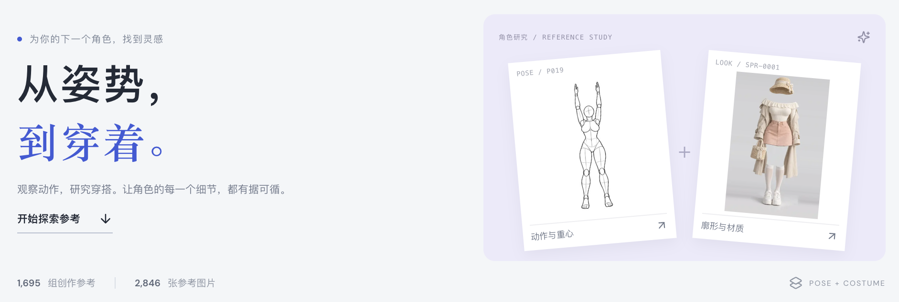
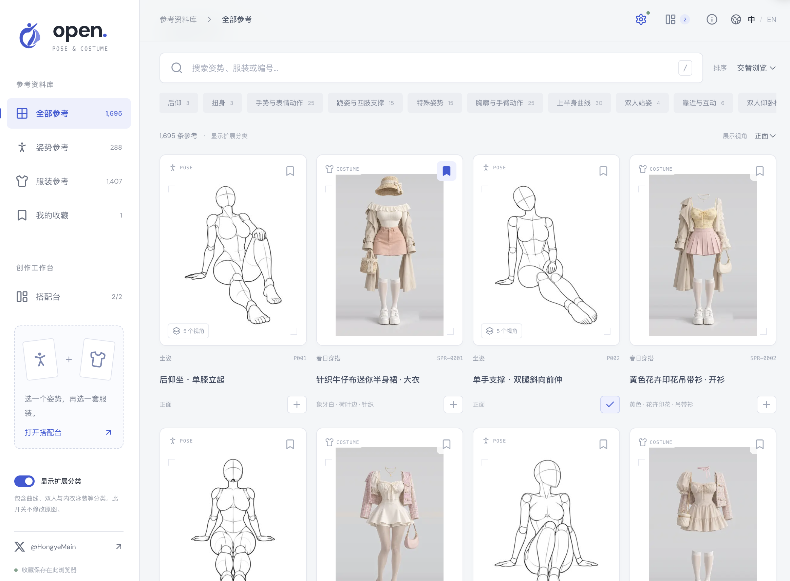
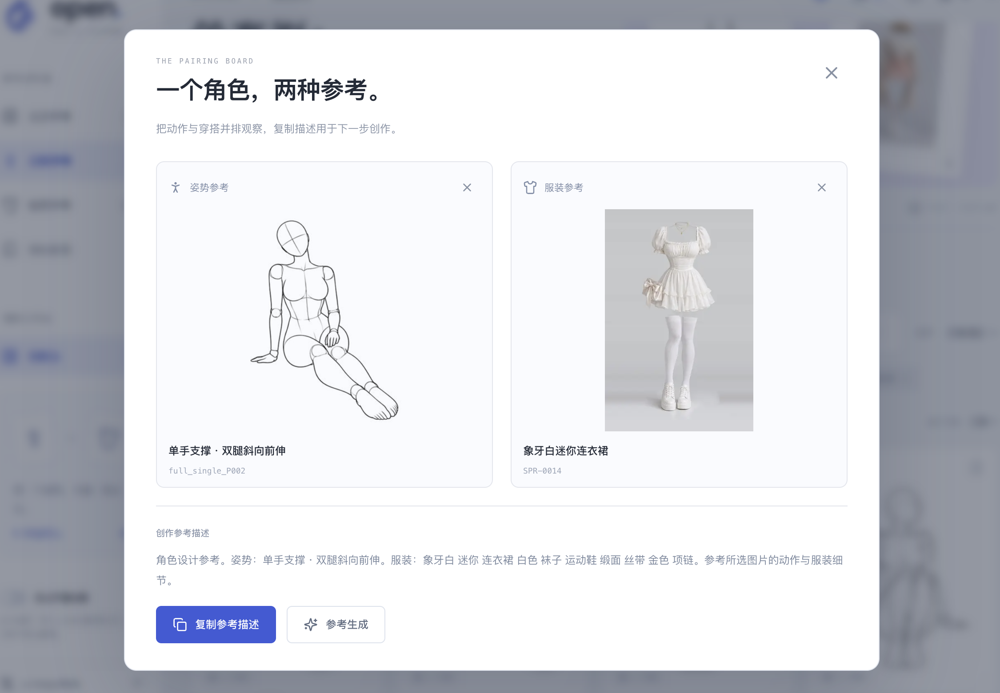
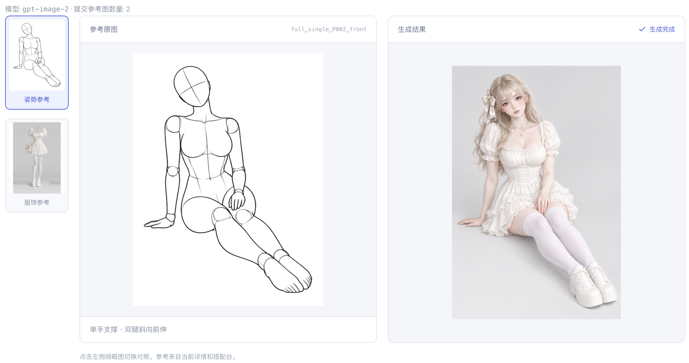
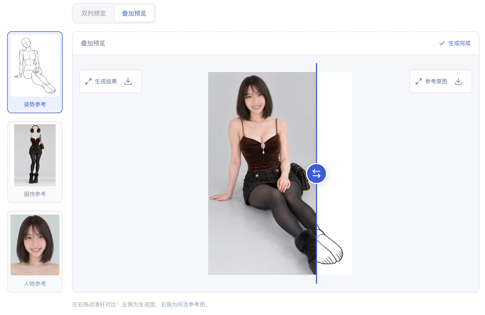

# Open Pose & Costume

**中文** · [English](README.en.md)

[在线体验](https://hongye007.github.io/open-pose-costume/) · [人物生成 Skill](https://github.com/hongye007/open-pose-costume-skill)

- **免费试用体验方式**：[查看飞书文档](https://my.feishu.cn/wiki/DuwOwjo0oiUrMAkVY8McigKcnsh)
- **作者 X 主页**：[@HongyeMain](https://x.com/HongyeMain)

从姿势，到穿着。一个面向角色设计、绘画练习与 AI 创作的中英文参考工作台，把查找素材、搭配参考、生成角色与对照预览放在一起。



**288 组姿势 · 1,439 个姿势视角 · 1,407 套服饰 · 1,499 张人物参考 · 4,345 张参考图**

以上为包含扩展分类的数据，更新于 2026-10-30（Asia/Shanghai）。

## 查找与收藏

- **中英文搜索**：支持名称、关键词、编号与多词检索，可跨语言查找参考。
- **分类与视角**：按姿势或服饰分类筛选、排序，切换姿势视角，查看缩略图与原图；扩展分类可按需开启。
- **收藏与分享**：收藏和搭配保存在当前浏览器，分享链接保留语言、筛选与参考选择。
- **随手浏览**：响应式布局、图片懒加载与逐批加载；支持 `/` 搜索、详情中 `←` / `→` 切换、`Esc` 关闭。



## 一个角色，两种参考

选一个姿势，再选一套服饰，加入搭配台。还可以从人物库选择或上传一张可选人物参考图，让生成结果保留人物身份与画风。组合描述会随选择更新，可以直接复制，用于创作或其他生图工具。

人物库包含 **893 张人脸、606 张人物造型图**，支持中英文搜索、发长筛选、收藏、原图预览和下载。原站仅提供完整的发长分类；部分发型描述包含发色，没有独立的瞳色、发色或肤色标注。



### 参考生成

1. 点击右上角设置图标，填写生图服务地址、API Key、模型、尺寸与质量。
2. 在搭配台选好**姿势和服饰**，按需从人物库选择或上传**人物参考图（可选）**，再点击“参考生成”。姿势和服饰缺少任一项时会提示补齐。
3. 等待生成结果；可编辑描述重新生成，失败时可手动重试。
4. 点击左侧姿势、服饰或人物缩略图切换对照参考，在“双列预览”和“叠加预览”之间切换。

| 配置项     | 默认值或要求                                              |
| ---------- | --------------------------------------------------------- |
| 服务地址   | `https://atomflow.vip`，可修改                            |
| 模型       | `gpt-image-2`，可修改                                     |
| 接口       | `POST /v1/images/edits`，OpenAI 兼容 multipart 格式       |
| 参考图     | 通过 `image[]` 上传姿势、服饰两张原图；选传人物图时共三张 |
| 浏览器访问 | 服务需允许 CORS；使用 HTTPS 或本机 HTTP 地址              |

配置保存在当前浏览器，API Key 默认仅保存到当前会话；勾选“记住密钥”后存入本地存储，可在设置中清除。生成时，浏览器直接向配置的服务发送参考图和描述，费用以该服务为准。密钥不会进入分享链接或仓库。

库中人物选择以素材编号保存在当前浏览器；列表使用缩略图，详情和生成使用原站 PNG 原图。人物参考控制身份与外貌，姿势与服饰参考控制动作和穿搭。

本地上传人物参考支持 PNG、JPG、WebP，最大 10 MB。上传图片仅保留在当前页面内存中，关闭搭配台后仍可使用，刷新或关闭页面即清除；不会写入浏览器存储、分享链接或仓库，仅在点击参考生成时发送至所配置的服务。

**双列预览**：所选参考与生成结果并排展示。



**叠加预览**：在同一个画框中拖动滑杆对比，左侧为生成图、右侧为所选参考；支持方向键与 Home / End。



上图为生成效果示例，实际结果取决于模型、描述与服务配置。

## 配套 Skill

[open-pose-costume-skill](https://github.com/hongye007/open-pose-costume-skill) 将姿势、服饰与人物参考组合生成为一张人物图，让你在 Codex 中通过自然语言使用这套创作流程。网站用于浏览和挑选参考，Skill 用于执行人物生成；安装方法、示例与生图服务配置见 Skill 仓库的中英文 README。

## 本地运行

需要 **Node.js 22.12+**。

```sh
npm ci
npm run dev
```

打开 <http://127.0.0.1:5199>。项目启用严格端口检查，占用时会退出；启动前请检查端口，或选择其他空闲端口：

```sh
npm run dev -- --port 5200
```

可用 `lsof -nP -iTCP:5200 -sTCP:LISTEN`（macOS/Linux）或 `Get-NetTCPConnection -LocalPort 5200`（Windows PowerShell）检查占用。

## 构建与部署

当前使用 [GitHub Pages](https://hongye007.github.io/open-pose-costume/) 部署。推送到 `main` 后，GitHub Actions 自动运行测试、以 `/open-pose-costume/` 为基础路径构建并部署；测试或构建失败时不会更新网站。其他分支及拉取请求只执行检查。

CI 使用稀疏检出，跳过 `pose/`、`costume/` 图片归档的下载与检出，保留测试和构建所需文件。

基于 **React 19 · TypeScript · Vite · Lucide**。参考库是静态网站，参考生成需自行配置生图服务。

```sh
npm run build
```

将 `dist/` 部署到静态托管平台即可。Cloudflare Pages 设置构建命令为 `npm run build`、输出目录为 `dist`。`public/_headers` 在 Cloudflare Pages 上提供缓存与安全响应头，GitHub Pages 不读取此文件。

本地预览同样选择空闲端口：

```sh
npm run preview -- --port 5200
```

## 数据与维护

网页直接加载原站图片，可用性取决于上游站点。本地图片归档不改变网站的图片地址。

人物库元数据来自 [AI Portrait Gallery](https://ai-portrait-gallery.pages.dev/)，人物原图与缩略图未下载或纳入仓库，也不包含在 `images:download` 命令中。

| 命令                      | 用途                                         |
| ------------------------- | -------------------------------------------- |
| `npm run sync`            | 同步上游元数据，不执行上游网页代码或下载图片 |
| `npm run data:build`      | 从本地快照重建网站索引                       |
| `npm test`                | 运行测试                                     |
| `npm run build`           | 类型检查并构建网站                           |
| `npm run images:download` | 可选：本地归档所有分类的封面与原图           |

元数据快照位于 `data/source/`，网站索引位于 `public/data/catalog.json`，同步记录位于 `data/sync-manifest.json`。同步会检查分类、视角及翻译完整性；如缺少翻译，按报错补充词表。

<details>
<summary>图片归档与品牌素材</summary>

图片归档保留姿势所有已有视角，当前数据共 5,692 个文件：

```text
pose/
  covers/       # 1,439 张 JPG 缩略图
  originals/    # 1,439 张 PNG 原图
costume/
  covers/       # 1,407 张 WebP 缩略图
  originals/    # 1,407 张 PNG 原图
```

封面与原图已纳入 Git，合计约 1.95 GiB；网站构建不包含这些归档，网页仍使用原站链接。维护者确认已获得原作者对本仓库公开再分发的额外授权，图片不适用代码的 MIT 许可，详见 [SOURCES.md](SOURCES.md)。

下载支持 SHA-256 校验、失败重试与已下载文件复用。默认并发数为 8，可用 `npm run images:download -- --concurrency 4` 调整。清单与统计分别写入 `data/image-download-manifest.json`、`data/image-download-summary.json`，下载记录仍由 Git 忽略。

Logo 原稿见 [生成原图](output/imagegen/open-pose-costume-logo-original.png)，提示词见 [logo-prompt.txt](assets/brand/logo-prompt.txt)。安装 Python Pillow、NumPy 后，运行 `python3 scripts/build-brand-assets.py` 可生成透明标志、favicon 和 Apple touch icon。

</details>

## 授权与致谢

人物库原站标注 [CC0 1.0](https://creativecommons.org/publicdomain/zero/1.0/)，同时请求避免图片数据转载与再分发；人物均为 AI 生成的虚构人物。两处说明均记录在 [SOURCES.md](SOURCES.md)。

项目代码使用 [MIT 许可](LICENSE)。图片、上游数据及第三方翻译保留各自权利，不随代码开放授权。姿势与服饰原站允许作品制作中的参考、编辑与商用，但禁止图片数据本身（包括加工后）的再分发、转载和转售。完整来源与使用限制见 [SOURCES.md](SOURCES.md) 和 [THIRD_PARTY_NOTICES.md](THIRD_PARTY_NOTICES.md)。

感谢原始姿势与服饰素材作者，以及中文翻译贡献者。
